# Landflow

**A low-code workflow platform where every node is a plugin, written in any language and autodiscovered over HTTP, gRPC or a message broker, with AI agents and agent teams as first-class citizens.**

Landflow follows n8n's model (items flowing between nodes, typed ports, cluster nodes for AI agents) and rebuilds the plugin layer around one language-neutral contract. A node is a JSON **descriptor** plus an **`execute`** behaviour. Built-in nodes implement exactly the same interface as external ones; they just run in-process. Write a node in TypeScript, Python or Go, start the process, and it shows up in the editor within a second, with its own icon, form and credentials, and no frontend code.

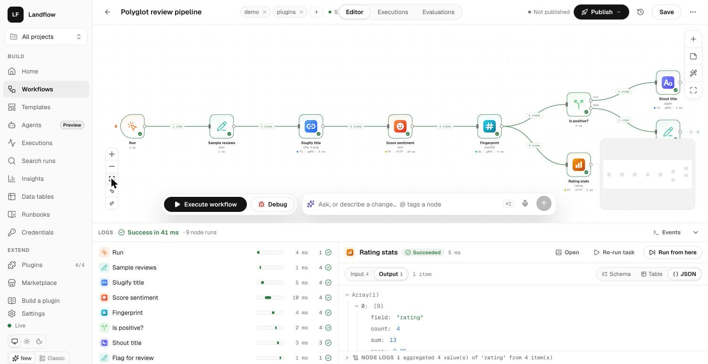

- [What is in the box](#what-is-in-the-box)
- [A tour](#a-tour)
- [Core concepts](#core-concepts)
- [The platform, area by area](#the-platform-area-by-area)
- [Architecture](#architecture)
- [Quick start](#quick-start)
- [Run with Docker and Kubernetes](#run-with-docker-and-kubernetes)
- [Repository layout](#repository-layout)
- [Tests](#tests)
- [Documentation](#documentation)

## What is in the box

| Area | What you get |
|---|---|
| **Build** | A canvas editor with a node creator, pinned data, a Logs panel, debugging with breakpoints, versions, templates and import from n8n and Flowise. **Spotlight**, the AI bar at the bottom of the canvas, drafts flows, proposes changes as reviewable diffs, tests and fixes them, and takes dictation. |
| **Run** | A durable engine: checkpoints after every node, retries, waits for time, forms and approvals, crash recovery, schedules, polling, webhooks, hosted chat, MCP triggers. Queue mode adds workers and high availability. |
| **Extend** | Plugins in TypeScript, Python and Go over HTTP, gRPC and ten message brokers, autodiscovered. A marketplace installs Claude Code plugin marketplaces as agents, skills, node plugins and flows. Composite nodes group nodes under a typed contract. |
| **AI** | The AI Agent and its model, memory, tool, retriever and reranker sub-nodes; RAG; guardrails; evaluations; standalone **agents** with personas, skills and channels; **agent teams** with a lead, reporting lines and reviewers; remote agents over A2A. |
| **Understand** | **Run Trace** tells a run as a story a person can follow. A **second brain** studies usage and suggests fixes. Insights, OpenTelemetry traces, metrics and logs across the host and every plugin. |
| **Integrate** | Messaging, productivity, Google Workspace, databases, GitHub, alert triage and Landfall war rooms, each a plugin, with OAuth2 and live pickers. |
| **Govern** | Users, roles and projects, API keys, OIDC, SAML and SCIM, a hash-chained audit log streamed to SIEMs, external secrets, protected environments, four-eyes publishing and Git sync. |

## A tour

Every screenshot below is a real screen from a local instance, running on a local Ollama model, with no cloud services.

### Home and plugins

The home page answers "how are we doing": workflows, runs in the last 24 hours, failures and which plugins are online, with the latest runs told as a short story each. The plugin registry shows every connected plugin, its language and its transport.

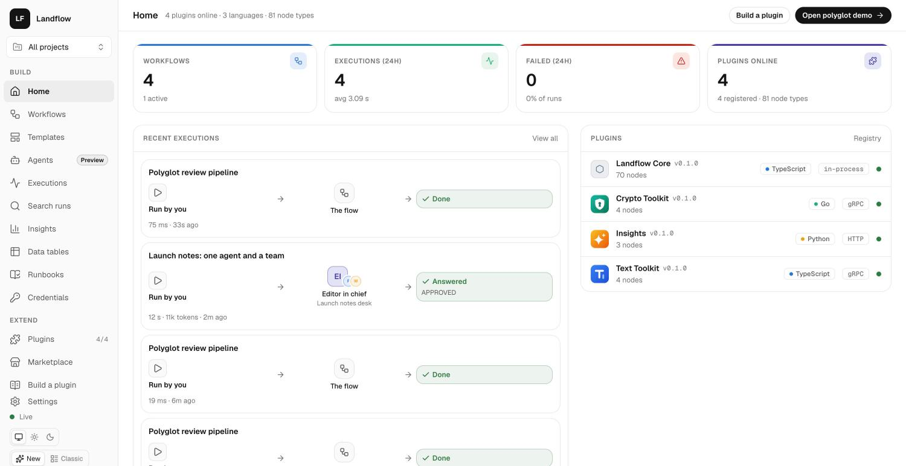

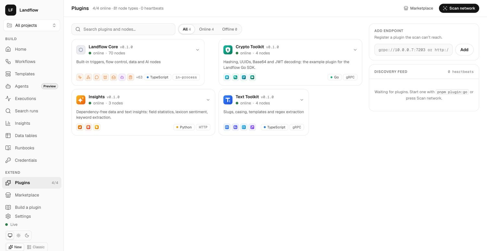

### Editor, with Spotlight

The editor is a canvas with a node creator, pinned data, a Logs panel that shows every node's input and output, and Spotlight, the bar at the bottom. Spotlight suggests what to ask without calling a model, tags nodes with `@`, proposes changes as diffs you apply or dismiss, and can test a workflow and fix it until a run passes.


### Dictation in Spotlight

Click the microphone, speak, click again. The recording goes to a speech-to-text server you control (a local Whisper keeps the audio on your machine) and the text lands in the box to edit. Nothing is sent by voice alone: you press Enter, and any change still waits for Apply.

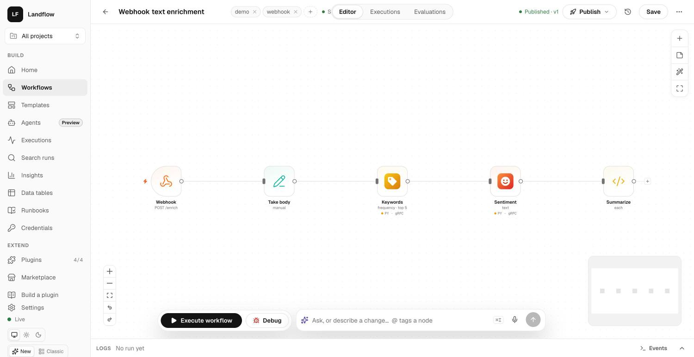

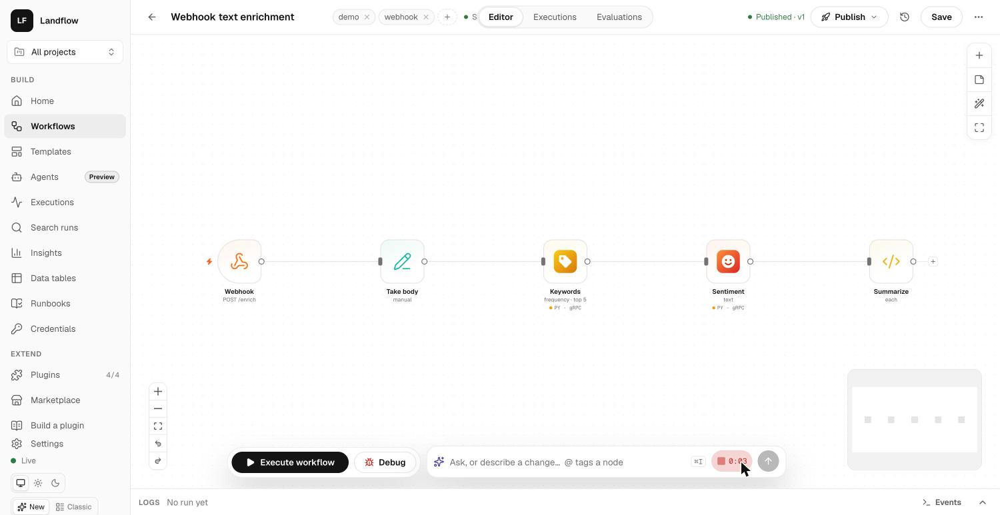

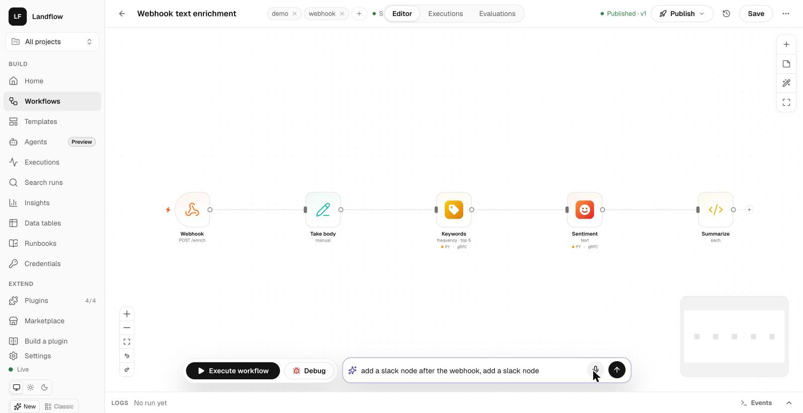

### Agents

An agent is a standalone assistant with a persona (role, who it helps, tone, rules, examples), a model, skills and capabilities. You talk to it in a test chat, publish it, and it then answers from a schedule, a channel (Slack, Telegram, Teams) or a workflow. The roster groups agents by team.

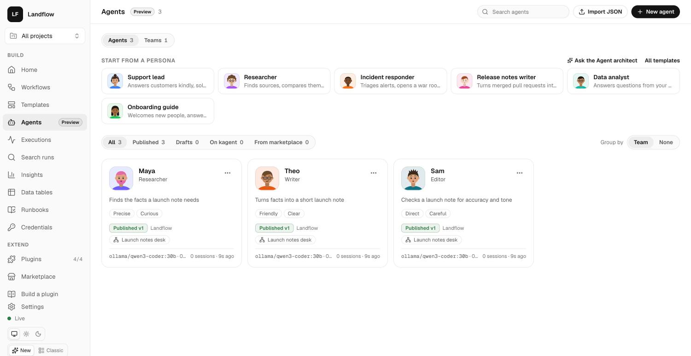

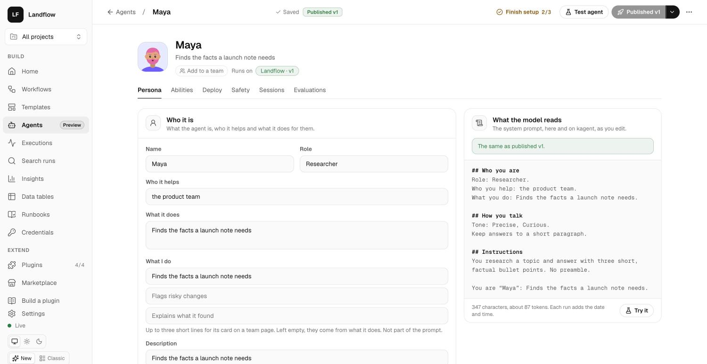

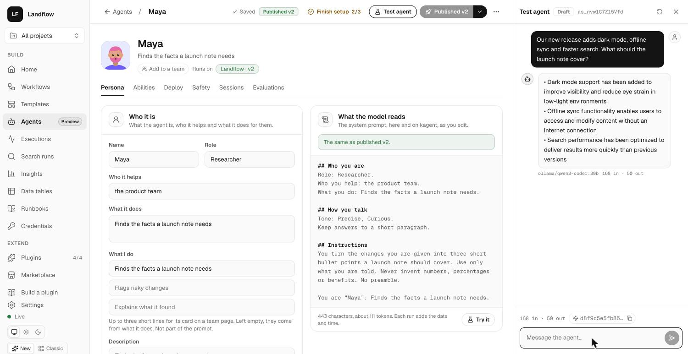

### Agent teams

A team is an org chart of agents: one **lead** runs the work, every other member reports to a manager, and a member can **review** another's work, so the manager cannot report done until the reviewer signs off. A **Run a Team** node runs a published team as one step of a flow.

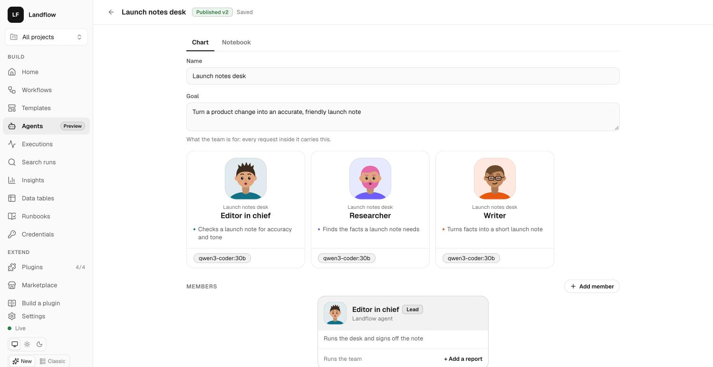

One flow, two ways to do the same task: a single agent on one branch, a team on the other. The team's node shows who is on it and what they did while it ran.

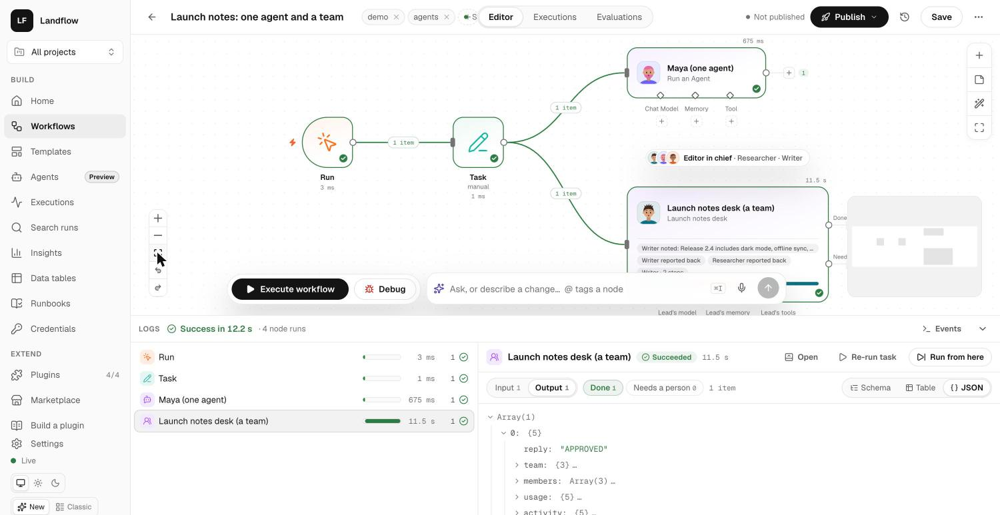

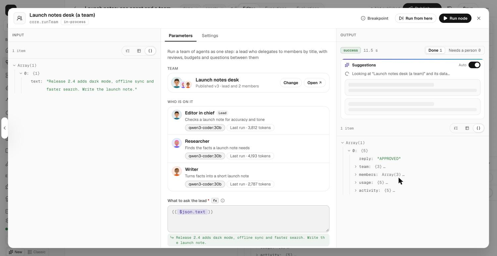

### Run Trace

Run Trace tells what happened in a run, live while it runs and afterwards, on a phone as well as on a desk. The **Story** reads like a log a person can follow, the **Team** tab shows who was asked what, and the **Trace** tab shows the requests between agents with their reasons and timings.

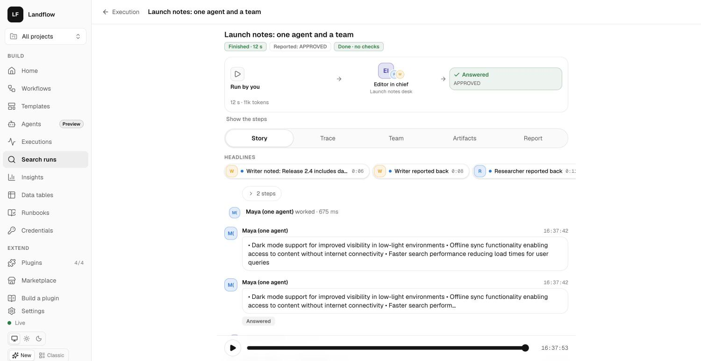

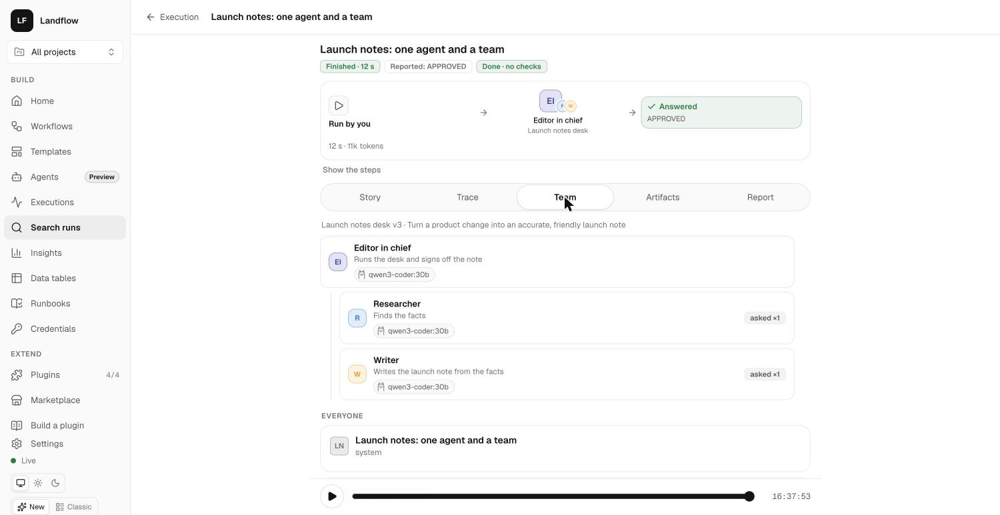

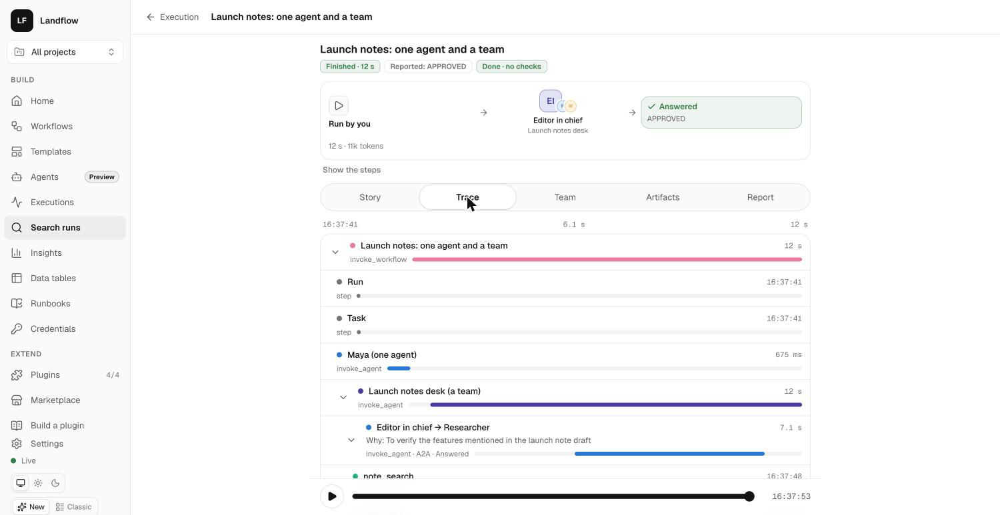

### Marketplace

The Marketplace installs from Claude Code plugin marketplaces: a plugin's agents become Landflow agents, its skills a skill library, and a node plugin is downloaded, run and supervised by the host. The built-in templates are ready-made flows.

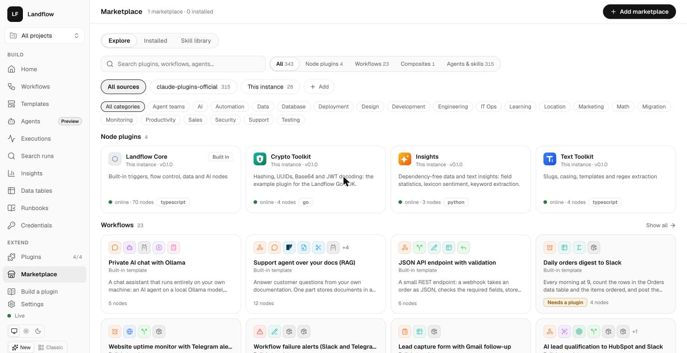

## Core concepts

| Concept | Meaning |
|---|---|
| **Item** | A unit of data: `{ json, binary?, pairedItem }`. A node receives items and returns one array of items per output. |
| **Node** | A step. It has a type (`core.set`, `text-toolkit.slugify`…), parameters, and typed input and output ports. |
| **Workflow** | Nodes and the connections between them, with drafts, published versions and a history. |
| **Plugin** | A process that serves node types over HTTP, gRPC, a broker or MCP. Any language with an SDK: TypeScript, Python, Go. |
| **Descriptor** | The JSON that describes a node: its name, ports, parameters and credentials. The editor renders the whole UI from it. |
| **Sub-node** | A model, memory, tool, retriever or reranker attached to an AI node through a typed port (`ai_languageModel`, `ai_tool`…). Any node that is `usableAsTool` can be an agent's tool. |
| **Agent** | A standalone assistant: persona, model, skills, capabilities, memory, channels and schedules, with draft and published versions. |
| **Team** | Agents with a lead, reporting lines, reviewers and token budgets, run as one step by the **Run a Team** node. |
| **Run Trace** | A journal of a run: who did what, requests between agents, waits, artifacts and checks. |
| **Composite** | A group of nodes typed by a contract (slots, rules, ports), checked in the editor and run as one step, with an optional fallback. |

## The platform, area by area

Each area has a page under [docs/](docs/README.md) with the details.

### Editor and assistant

A canvas with a node creator, a Logs panel, pinned data, breakpoints, workflow versions and templates, and import from n8n and Flowise ([editor](docs/features/editor.md)). **Spotlight** ([assistant](docs/assistant.md)) is the one AI surface: bubbles that complete `@` mentions and node types without a model call, a builder chat that proposes changes as diffs, after-run suggestions, **Test and fix** (run, fix failures, run again, then offer to publish), and **dictation**. It drafts a whole flow from one sentence on an empty canvas, and while it works the conversation folds into a side card so the canvas stays in view.

### Engine

n8n's data model with a durable runtime: a checkpoint after every node, retries and timeouts per node, waits for time, forms, approvals and sub-executions, and crash recovery from the last checkpoint. Triggers cover webhooks, forms, schedules, polling, chat, MCP and app webhooks, with idempotency keys, debounce, concurrency slots and rate limits. The Code node runs JavaScript and Python in process or in a sandboxed code runner ([engine](docs/features/engine.md)).

### Plugins, protocol and SDKs

A plugin is a process that speaks `landflow.plugin/v1` ([protocol](docs/protocol.md)): `GetManifest`, `Execute`, `LoadOptions`, `TestCredentials`, `Health` and the app-webhook methods, over an HTTP binding and a gRPC binding. SDKs for TypeScript, Python and Go share one shape: a node interface, `serve()` with the faces to start, one dispatcher, an announcer, and helpers for credentials, binary data, signatures and telemetry. The host finds plugins by their announcements, by scanning, or from labelled Kubernetes Services ([plugins](docs/plugins.md)).

### Transports

Calls between the host and a plugin go over HTTP, gRPC or a message broker: Kafka, RabbitMQ, NATS and JetStream, Valkey, MQTT, SQS and more. An **Auto** selector picks a transport per call, large payloads travel as claim checks, and every plugin can also be exposed as an MCP server through the bundled agentgateway ([transports](docs/transports.md), [MCP gateway](docs/mcp-gateway.md)).

### AI

The AI Agent and the chains take a model, memory, tools, retrievers and rerankers on typed ports. Model adapters (Anthropic, OpenAI-compatible, Ollama) stream tokens and price every call. Around them: RAG with vector stores, embeddings, loaders and rerankers; guardrails; tool approvals in the editor, Slack, Teams or by email; usage caps per agent, credential and user; evaluations, offline and online; hosted chat and an embeddable widget; MCP as client, server trigger and gateway ([AI](docs/features/ai.md)).

### Agents and teams

**Standalone agents** have personas with a voice, rules and examples, skills, capabilities (any action node, workflows, other agents, MCP servers), knowledge, memory, schedules and channels, and the **Agent architect** chat designs new ones ([agents](docs/agents.md)). **Teams** add a lead, reporting lines, reviewers, consulting between peers, token budgets and an org chart, and share a **notebook** of notes members write as they work ([agent teams](docs/agent-teams.md), [team notebook](docs/team-notebook.md)). Remote agents, such as Claude Code on kagent, join over **A2A** ([a2a](docs/a2a.md)). Agents and teams export as Claude Code plugins ([marketplace](docs/marketplace.md)).

### Run Trace and the second brain

Run Trace turns a run's journal into a Story, a Trace, a Team view, Artifacts and a Report, with profiles that add a domain's words and checks, and a **Run report** node that checks what every actor said against what the record shows ([run trace](docs/run-trace.md)). The **second brain** studies what people and agents do, keeps a usage ledger, runs detectors, and fills a Suggestions inbox with fixes, cheaper or faster versions, schedules and new workflows; you can build your own conclusions as workflows ([second brain](docs/second-brain.md)).

### Integrations and alert triage

Messaging, productivity, Google Workspace, databases and GitHub ship as plugins with OAuth2 and live pickers ([integrations](docs/features/integrations.md)). Three more plugins and seven flows decide whether an alert is a real incident and only then open a war room in Landfall; closed war rooms become **runbooks** found by alert kind ([triage](docs/triage.md), [runbooks](docs/runbooks.md)).

### Identity, governance and operations

Local users, OIDC, SAML and SCIM; roles and projects; API keys with scopes; node, HTTP host and MCP allow-lists; four-eyes publishing; protected environments; Git sync with a branch per environment; external secrets from OpenBao, Vault, 1Password, AWS, GCP and Azure; and an audit log in a SHA-256 hash chain that is streamed to SIEMs and signed ([authentication](docs/features/authentication.md), [audit and governance](docs/features/audit-and-governance.md), [secrets and environments](docs/features/secrets-and-environments.md), [Git sync](docs/features/git-sync.md)). Every process speaks OpenTelemetry ([observability](docs/features/observability.md)), and a CLI, an HTTP API and every environment variable are documented ([CLI](docs/features/cli.md), [API](docs/reference/api.md), [configuration](docs/reference/configuration.md)).

## Architecture

The full description is [docs/architecture.md](docs/architecture.md). This is the shape of it.

### The pieces

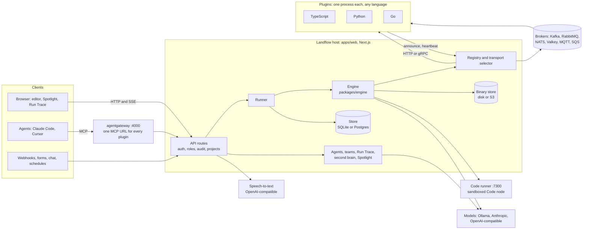

| Process | What it does | Code |
|---|---|---|
| **Host** | UI, REST API, webhooks, forms, hosted chat and MCP endpoints; runs executions in regular mode; the leader runs schedules, polls and timers | `apps/web` |
| **Worker** (queue mode) | takes production runs from a Valkey stream and runs them through the same runner | `apps/web` (`pnpm worker`) |
| **Plugins** | serve node types over HTTP, gRPC, brokers and MCP | `plugins/*`, SDKs in `packages/sdk`, `sdks/go`, `sdks/python` |
| **Code runner** | runs Code node JavaScript and Python in a fresh locked-down process per run | `services/code-runner` |
| **MCP gateway** | agentgateway: one MCP URL for every plugin, sign-in, prefixes, rate limits | `deploy/mcp-gateway` |
| **Bridge** | gives Go and Python plugins the broker kinds their SDK has no native driver for | `services/landflow-bridge` |
| **CLI** | `landflow`: workflows, runs, Git sync, environments, n8n import, with stable JSON output | `packages/cli` |

### A run, end to end

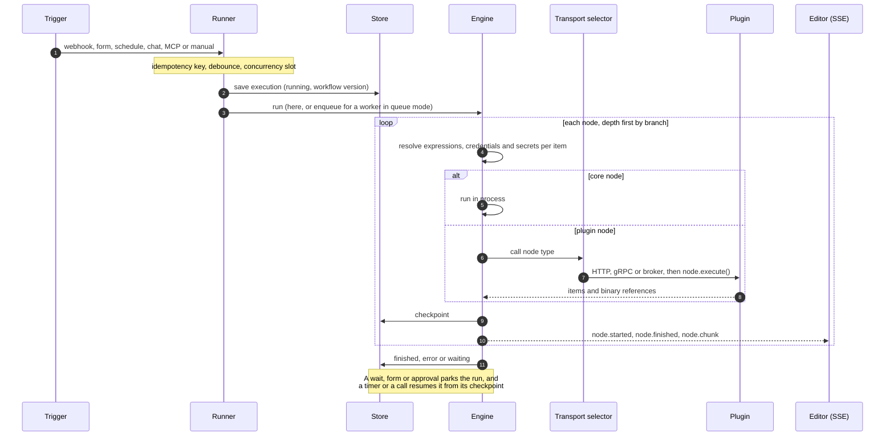

A run can stop and come back. A Wait node, a form, an approval or a sub-execution saves the run as `waiting` with its resume state, and a timer, a call to `/api/waiting/<id>` or the child's result resumes it on the version it started with. A crash leaves it `running`, and the next boot, or another worker once the lease runs out, continues from the last checkpoint.

### Plugins and the protocol

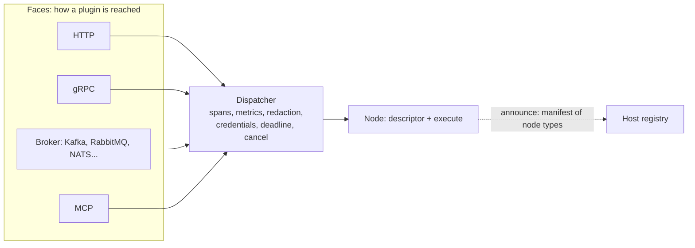

Every SDK has the same shape, so a node written in any language is called the same way: a descriptor mirrors n8n's, the host resolves `{{ expressions }}` before the call so the plugin only ever sees concrete values, credentials are stored and decrypted by the host and sent with each call, and binary data travels as references that plugins read and write through `/api/binary`.

### Agents and teams

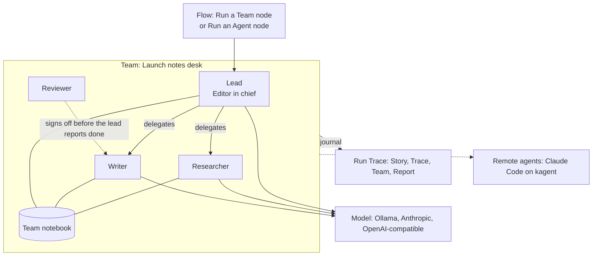

Members are Landflow agents or remote agents over A2A. Every request inside a team carries the team's goal, each member can have a token budget (a warning at 80 percent and a stop at 100), and the whole run is written to the Run Trace journal, which serves the Story, Trace, Team and Report screens and can be exported over OTLP with OpenInference kinds.

### Queue mode and high availability

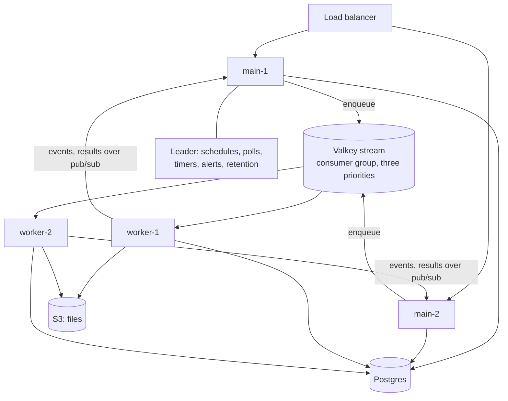

`LANDFLOW_EXECUTIONS_MODE=queue` makes mains enqueue production runs and workers run them. A run holds a lease renewed by heartbeats, and when a worker dies another claims its jobs and continues each run from its checkpoint. Valkey Sentinel or Cluster gives failover, and with shared state in Postgres any main serves any request.

### Storage and observability

| What | Where |
|---|---|
| Workflows, versions, executions, checkpoints, waits, users, projects, settings, data tables, audit events | SQLite (WAL) or Postgres |
| Files (binary data) | the filesystem or S3 (MinIO), deleted with their execution |
| Credentials, agents and their sessions | encrypted files in the data directory, or the database in queue mode |
| External secrets | OpenBao, Vault, 1Password, AWS, GCP, Azure: resolved at run time, never stored |

The host traces each execution, node and plugin call, and the SDKs continue the trace inside the plugin, so one trace shows the editor click, the engine, the broker hop and the node's own HTTP calls. Metrics cover flows, queues, transports, workers, AI usage and every plugin, and `/api/metrics` serves Prometheus text.

## Quick start

```bash
pnpm install
(cd plugins/py-insights && ./setup.sh)    # venv with grpcio for the Python plugin (one-off)
pnpm dev:all                              # host :3000 + the example and integration plugins
```

Open http://localhost:3000 and create the owner account on the setup page, or start with `LANDFLOW_OWNER_EMAIL` and `LANDFLOW_OWNER_PASSWORD` set (see [Authentication](docs/features/authentication.md)). The plugins announce themselves within a second and their nodes appear in the editor. Three example workflows are seeded on first boot:

| Workflow | Shows |
|---|---|
| **Polyglot review pipeline** | TS slugify, Python sentiment, Go hash, an IF, branches and Python stats, all over gRPC |
| **Polyglot AI agent** | Chat to an AI Agent with a local Ollama model, memory, and tools written in Go, Python and TS |
| **Webhook text enrichment** | `curl -XPOST localhost:3000/api/webhook/enrich -d '{"text":"…"}'` |

To run the pieces separately: `pnpm dev`, `pnpm plugin:ts`, `pnpm plugin:py`, `pnpm plugin:go`, and the integrations (see [Integrations](docs/features/integrations.md)). `plugins/productivity/setup.sh` makes the Python integrations' venv.

### Local models

Agents, teams and Spotlight use a local [Ollama](https://ollama.com) by default (`OLLAMA_URL`, `LANDFLOW_BUILDER_MODEL`, default `qwen3-coder:30b`), so nothing leaves your machine. Anthropic and any OpenAI-compatible API are a per-agent choice.

### Dictation

The microphone in Spotlight needs a speech-to-text server with an OpenAI-compatible `/audio/transcriptions` endpoint. A local one keeps audio on your machine:

```bash
docker run -d --name landflow-stt -p 127.0.0.1:8000:8000 ghcr.io/speaches-ai/speaches:latest-cpu
curl -X POST http://127.0.0.1:8000/v1/models/Systran/faster-whisper-small     # download a model once
LANDFLOW_STT_URL=http://127.0.0.1:8000/v1 LANDFLOW_STT_MODEL=Systran/faster-whisper-small pnpm dev
```

See [the assistant page](docs/assistant.md#spotlight) for what dictation does and does not do.

## Run with Docker and Kubernetes

```bash
docker compose -f deploy/compose.infra.yml up -d --wait                     # Postgres+pgvector, Valkey, Mailpit, MinIO, OpenBao
docker compose -f deploy/compose.infra.yml --profile auth --profile observability up -d --wait   # + Keycloak, Jaeger
COMPOSE_BAKE=false docker compose -f deploy/compose.yml up -d --build --wait  # host + 7 plugins + code runner on http://localhost:53000
```

The first command starts the development and test infrastructure. The last one runs Landflow itself from images: the host as Next.js standalone output with its data in a volume, and one image per plugin, each announcing itself to the host by its service name. Ports, credentials, how the dev server uses the infra, and how to reset everything are in **[docs/deployment.md](docs/deployment.md)**.

**Kubernetes:** `deploy/k8s/` (kustomize) runs the host and the plugins on a cluster, where the host discovers the plugins from labelled Services (`kubectl --context orbstack apply -k deploy/k8s/overlays/orbstack` on OrbStack). Queue mode, KEDA autoscaling examples, telemetry and running agents on [kagent](https://kagent.dev) are covered in [docs/deployment.md](docs/deployment.md#kubernetes) and [docs/a2a.md](docs/a2a.md).

## Repository layout

```
apps/web/                 the host: UI pages, API routes, server libs (src/lib/server), tests
packages/                 engine (executor), protocol (wire contract, schemas, plugin.proto, MCP mapping),
                          sdk (TypeScript SDK), transports (messaging core and broker drivers), cli
sdks/                     the Go and Python SDKs, with their transport cores and drivers
plugins/                  one example plugin per SDK, plus the integrations: messaging (TS), productivity (Python),
                          google-workspace and databases (Go), github, and the triage plugins
services/                 code-runner (the Code node's sandbox), landflow-bridge (broker kinds for Go and Python)
deploy/                   compose stacks, Dockerfiles, Kubernetes manifests, the MCP gateway config
docs/                     every document: features, architecture, protocol, deployment, development, roadmap
```

## Tests

```bash
pnpm test && pnpm typecheck                        # protocol/sdk/engine/plugin/code-runner, then every package's types
(cd apps/web && npx vitest run)                    # the host: route handlers, store, runner, auth, AI…
```

The full list (every package and SDK, the live broker suites, `LANDFLOW_INTEGRATION` tests against the infra stack and the cluster) is in [docs/development.md](docs/development.md#verification).

## Documentation

[docs/README.md](docs/README.md) is the index: where to start, every document with one line on what it covers, and which document covers each feature. The ones to read first:

- **[architecture.md](docs/architecture.md)**: the processes, a run end to end, every subsystem and a map of the code.
- **[development.md](docs/development.md)**: setup, conventions, and every test command.
- **[deployment.md](docs/deployment.md)**: Docker, Kubernetes and the infra stack.
- **[limitations.md](docs/limitations.md)** and **[roadmap.md](docs/roadmap.md)**: what Landflow does not do yet, and what each wave built. [history.md](docs/history.md) lists every change in order.

### Research

Agents read the source of the running n8n 2.44 container, its node catalogue and its docs. Their reports drove this design:

- [docs/research/01-n8n-node-interface.md](docs/research/01-n8n-node-interface.md): `INodeType`, the property vocabulary, loaders and lazy manifests
- [docs/research/02-n8n-workflow-engine.md](docs/research/02-n8n-workflow-engine.md): workflow JSON, `WorkflowExecute`, expressions and push events
- [docs/research/03-n8n-ai-agents.md](docs/research/03-n8n-ai-agents.md): cluster nodes, `supplyData`, tools and `$fromAI`, agent v3 and `@n8n/agents`
- [docs/research/04-n8n-integrations.md](docs/research/04-n8n-integrations.md): which of n8n's 445 integrations people use, how n8n shapes them, and the set Landflow builds
