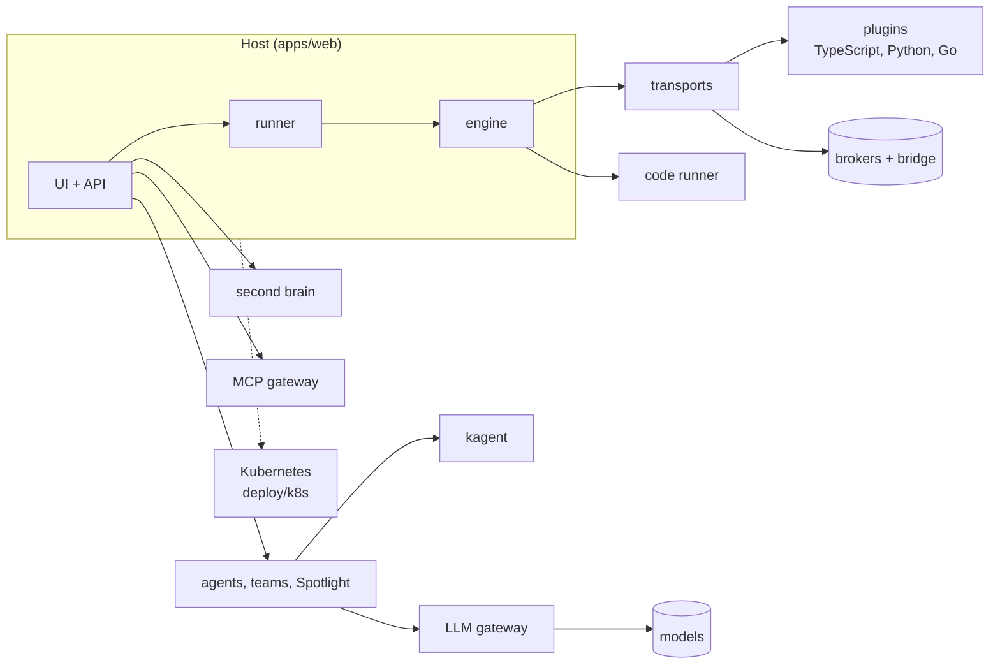

# Landflow platform guide

A guide to the whole platform for people, with a skill beside each page that tells Claude how to do the same job. Part of
the [Landflow docs](../README.md).

Landflow is a low-code workflow platform modelled on n8n, where every node is a plugin written in any language
(TypeScript, Python, Go) and found over HTTP, gRPC or a message broker. The host is a Next.js app; it runs workflows
with an engine, calls plugins through a transport it picks per call, and adds agents, a second brain, an LLM gateway
and MCP gateways around them. It runs locally on Docker and Kubernetes (OrbStack), with no cloud deploy.

## The parts

| Part | What it is | Where |
|---|---|---|
| Host | the Next.js app: UI, REST API, webhooks, MCP endpoints, runs | `apps/web` |
| Engine | runs a workflow: items, expressions, retries, checkpoints | `packages/engine` |
| Protocol | the plugin contract `landflow.plugin/v1`: types, JSON Schema, `plugin.proto` | `packages/protocol` |
| SDKs | TypeScript, Python and Go libraries a plugin is built with | `packages/sdk`, `sdks/python`, `sdks/go` |
| Transports | HTTP, gRPC and the broker drivers, chosen per call (Auto) | `apps/web/src/lib/server/transports`, `packages/transports` |
| Plugins | the bundled nodes, one process each | `plugins/*` |
| Code runner | sandbox for the Code node | `services/code-runner` |
| Broker bridge | broker kinds for Go and Python plugins | `services/landflow-bridge` |
| Agents runtime | in-host agent loop; kagent (ADK or Claude Code harness) over A2A | `lib/server/agents`, `lib/server/kagent` |
| LLM gateway | LiteLLM in front of every model call | `deploy/llm-gateway`, `lib/server/llm-gateway` |
| MCP gateway | agentgateway: one MCP URL for every plugin | `deploy/mcp-gateway`, `lib/server/mcp` |
| Brain | usage ledger, detectors, suggestions, facts, practices, work briefings | `lib/server/brain`, `lib/server/practices` |
| Kubernetes | base, components and overlays; the OrbStack cluster | `deploy/k8s` |

## The pages and the skills

Each skill is a `SKILL.md` in the `landflow-dev` plugin (`claude-plugins/landflow-dev/skills/<name>/`). Opening this
repository with Claude Code loads them from `.claude/skills/`, and any other repository can install the plugin from this
repository's marketplace. A skill links to its page here instead of repeating it.

| Page | What it answers | Skill |
|---|---|---|
| [overview.md](overview.md) | what Landflow is made of, how a run goes from trigger to Run Trace, the data, identity, the AI parts, the repo layout | `landflow-platform-overview` |
| [server-layers.md](server-layers.md) | the host's layers (routes, `handler()`, access, validation, services, engine, store, plugins, queue, jobs, public API, client) and how to add a route end to end | `landflow-server-change` |
| [agents.md](agents.md) | what an agent is, where it runs (in-host, kagent, Claude Code, LiteLLM, Ollama), teams, the agent nodes, the routes | `landflow-agents` |
| [kubernetes.md](kubernetes.md) | the components Landflow uses in Kubernetes and how to run, change and check them locally | `landflow-kubernetes` |
| [sdk/README.md](sdk/README.md) | what a plugin is and how the three SDKs compare | `landflow-plugin-typescript`, `landflow-plugin-python`, `landflow-plugin-go` |
| [sdk/typescript.md](sdk/typescript.md) | writing a plugin with `@landflow/sdk` | `landflow-plugin-typescript` |
| [sdk/python.md](sdk/python.md) | writing a plugin with `landflow_sdk` | `landflow-plugin-python` |
| [sdk/go.md](sdk/go.md) | writing a plugin with `sdks/go` | `landflow-plugin-go` |
| [sdk/capabilities.md](sdk/capabilities.md) | what an SDK gives a plugin: credentials, binary data, triggers, transports, MCP, telemetry | the three plugin skills |

## Where to read next

- [../architecture.md](../architecture.md): every subsystem and a code map.
- [../development.md](../development.md): setup, where to start reading, conventions and every test command.
- [../constitution.md](../constitution.md): the rules every change starts from.
- [../limitations.md](../limitations.md) and [../roadmap.md](../roadmap.md): what is missing, and what each wave built.
- The contributor agents in [`.claude/agents/`](../../.claude/agents) and the feature skill
  [`.claude/skills/landflow-feature`](../../.claude/skills/landflow-feature/SKILL.md) are for working on this repository
  itself; they point at the constitution.
