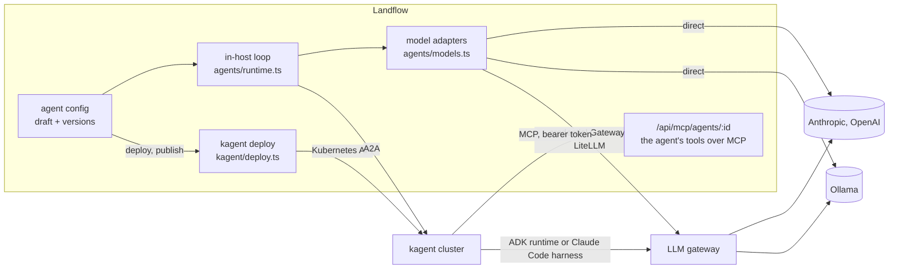

# Agents

What a Landflow agent is, where it runs, how a flow calls it, and the routes that make, publish and chat with one. Part
of [the platform section](README.md). The skill that does the job is `landflow-agents`. The product page, with every
setting, is [../agents.md](../agents.md); this page is the map and the reasons.

- [What an agent is](#what-an-agent-is)
- [Where agents run](#where-agents-run)
- [Teams](#teams)
- [How flows call agents](#how-flows-call-agents)
- [Spotlight and the Agent architect](#spotlight-and-the-agent-architect)
- [The brain and practices](#the-brain-and-practices)
- [MCP surfaces](#mcp-surfaces)
- [The API](#the-api)
- [Where the code is](#where-the-code-is)

## What an agent is

A standalone agent is a saved configuration that Landflow runs for you, with sessions, memory and versions. It is not
the **AI Agent** node, which lives inside one workflow with its model, memory and tools wired as sub-nodes
([../agents.md](../agents.md) opens with the comparison).

| Part | What it holds | Type |
|---|---|---|
| Persona | role, who it helps, mission, tones, length, language, sign-off, Always and Never rules, up to 10 examples | `AgentPersona`, `lib/shared/persona.ts` builds the system prompt from it |
| Instructions | free text for what the persona parts do not cover | `AgentConfig.instructions` |
| Model | a provider (`anthropic`, `openai` or `ollama`), a model, an optional credential, a base URL, a temperature | `AgentModel` |
| Skills | Agent Skills: a "use when" line that is always in the prompt, and instructions loaded on demand by `load_skill` | `AgentSkill` |
| Tools | `node` (any action node), `workflow`, `agent` (a sub-agent), `mcp`, `knowledge` (vector store, or a plugin node) and `a2a` (a remote agent) | `AgentToolConfig` |
| Triggers | schedules and channels (Telegram, Slack, Microsoft Teams) | `AgentSchedule`, `AgentChannel` |
| Safety | guardrails per stage (input, tool result, output), limits (iterations, tokens, cost), tool access rules | `AgentGuardrails`, `AgentSettings`, `AgentAccess` |
| Tuning | model router, prompt cache, response cache, project context and practices switches | `AgentRouter`, `AgentCache` |

The types are in `apps/web/src/lib/shared/agents.ts` (`AgentConfig` at line 357); the request schema that validates a
saved draft is `agentConfigSchema` in `lib/server/agents/http.ts`.

**Versions and publishing.** Everything a person edits autosaves to the **draft**. The test chat always runs the draft.
**Publish** snapshots the draft as version N (the last 20 are kept); schedules, channels, the **Run an Agent** node and
kagent use the published version, and a session stays on the version it started with. Publishing needs a model and a
persona part or instructions (`app/api/agents/[id]/publish/route.ts`). **Restore** copies an old version into the draft and
publishes nothing.

**The eval gate.** An agent can carry test cases (`input`, optional `expected`). On publish the draft is run against them
and an LLM judge scores each answer 1 to 5; the publish is held with 409 when the average is under 3, or more than 0.5
under the published version's last average, unless the request says `{ "skipEval": true }`. An agent with no cases
publishes as before. Code: `lib/server/agents/eval-gate.ts`.

**Projects and sharing.** An agent belongs to a home project and is available there, in projects it is shared with
(`PUT /api/agents/:id/shares`) and, if shared with all, everywhere. A session is read and continued only from the project
it ran in. See [../projects-and-goals.md](../projects-and-goals.md#agents-across-projects).

**Storage.** Files under the data directory, or with `LANDFLOW_CONFIG_STORE=database` (the default in queue mode) the
`agent_definitions`, `agent_sessions` and `agent_memory` tables. `agentStore` (`lib/server/agents/store.ts:634`) hides the
difference.

## Where agents run



| Runtime | What runs the loop | When to pick it | Details |
|---|---|---|---|
| **The in-host loop** | `runAgent()` in `lib/server/agents/runtime.ts:300`, inside the host (or a worker) | the default: test chat, schedules, channels, flows, tasks. Tools run in Landflow with the caller's rights; approvals, guardrails, memory and usage limits are all here | [../agents.md#how-a-run-works](../agents.md#how-a-run-works) |
| **kagent, ADK runtime** | kagent's own runtime in a Kubernetes cluster, with Landflow's persona as the system prompt | the agent should live as a Kubernetes resource and be called by other A2A clients | [../a2a.md#landflow-agents-on-kagent](../a2a.md#landflow-agents-on-kagent) |
| **kagent, Claude Code harness** | Claude Code in a gVisor sandbox, with the agent's Claude Code plugins loaded | an agent that needs a shell, files and Claude Code's own tools; the **landflow-harness mod** reports its tokens and tool calls back, because Claude Code sends no usage | [../a2a.md#on-claude-code](../a2a.md#on-claude-code), [../a2a.md#the-landflow-harness-mod](../a2a.md#the-landflow-harness-mod) |

What a kagent deployment is: Landflow writes five resources (an `AgentTemplate` with the system prompt, a `RemoteMCPServer`
pointing at `/api/mcp/agents/<id>`, a `ModelConfig`, an `Agent` and a Secret) with server-side apply, on deploy and on every
publish (`lib/server/kagent/deploy.ts`: `deployToKagent` line 268, `redeployIfDeployed` line 361). The card compares what
kagent holds with what Landflow would write and names the drift. Cross-session memory, guardrails, schedules and channels
stay in Landflow. A kagent agent needs a **kagent cluster** credential (`core.kagentApi`), and kagent itself runs in a kind
cluster next to Landflow ([../a2a.md#kagent-next-to-landflow](../a2a.md#kagent-next-to-landflow),
`deploy/scripts/kagent-up.sh`). It is local-only in this repository.

**Models.** The model is a setting, so the components behind it are swappable (`lib/server/agents/models.ts`):

- **Ollama** (local): the agent's own **Server URL**, else `OLLAMA_URL`, else `http://127.0.0.1:11434`. Inside a
  container or a pod, `127.0.0.1` is the container itself: use `http://host.docker.internal:11434`
  (`deploy/.env.example`, the OrbStack overlay, [../deployment.md](../deployment.md)).
- **Anthropic** and **OpenAI-compatible**: a `core.anthropicApi` or `core.openAiApi` credential, or `ANTHROPIC_API_KEY`.
- **The LLM gateway**: set the credential's **Gateway** to LiteLLM, with the proxy as Base URL and a virtual key as API key.
  The call then carries who is calling (project, agent, person), and LiteLLM's call id and cost are kept on the AI call
  ([../llm-gateway.md](../llm-gateway.md#point-landflow-at-it)). A deployed agent can get a virtual key of its own, whose
  budget is the agent's dollar limit.
- **The router** sends short, simple messages to a cheaper model by a plain rule, with no model call.

## Teams

Two different things carry the word. The **team label** on the roster only groups cards. An **agent team** (`agent-teams`
everywhere: routes, table, resource kind `agentTeam`) is a set of agents with standing relations: one lead, every other member
reporting to exactly one manager, reviewers who must sign off, and peers a member may consult. Members are Landflow agents or
remote A2A agents. A team publishes like an agent (`POST /api/agent-teams/:id/publish` is refused with the list of issues
until the chart is valid) and a flow runs it with the **Run a Team** node. Code: `lib/server/agent-teams/`
(`store.ts`, `runtime.ts`), rules in `lib/shared/agent-teams.ts`. See [../agent-teams.md](../agent-teams.md) and
[../team-notebook.md](../team-notebook.md).

## How flows call agents

| Node | Type id | What it does |
|---|---|---|
| Run an Agent | `core.messageAgent` | runs a **published** agent as one step; optional ports for a chat model, memory and tools; also usable as a tool (takes `message` and `reason`). Runs on Landflow's runtime even if the agent is deployed to kagent. Tools that need approval ask in the editor's chat when Tool Approvals is set to 'Ask in the editor's chat' (new starter flows set it), and are refused otherwise, because a flow run has nobody to approve |
| Run a Team | `core.runTeam` | runs a published team; outputs **Done** and **Needs a person** |
| A2A Agent | `core.a2aAgent` | sends a message to a remote A2A agent (a kagent agent, say), answers its pauses, gets or cancels a task |
| When Called by a Workflow or Agent | `core.workflowTrigger` | makes a workflow an agent tool; its arguments become the tool's JSON schema |
| Execute Workflow | `core.executeWorkflow` | one workflow runs another |
| AI Agent | `core.aiAgent` | the in-workflow agent (not the standalone agent) |

The nodes are defined in `lib/server/nodes/agents.ts` (`messageAgent` line 133), `nodes/run-team.ts`, `nodes/a2a.ts` and
`nodes/ai.ts`. A Run an Agent node in a saved workflow:

```json
{ "id": "n2", "name": "Run an Agent", "type": "core.messageAgent", "position": [260, 0],
  "parameters": { "agentId": "ag_...", "message": "{{ $json.text }}", "conversation": "new" } }
```

It outputs `{ reply, sessionId, agentId, version, model, endReason, usage, steps }`. The agent's session carries the
execution id, so the run view shows the agent's timeline live. Changing workflows is best done through the editor's
Spotlight; a saved workflow can also be read and written through `/api/workflows`.

## Spotlight and the Agent architect

Spotlight, the builder chat in the editor, proposes a new agent as one of its operations (`newAgent`); the editor calls
`POST /api/agents/design`, and the **Agent architect** designs it without a conversation (`designAgent` in
`lib/server/assistant/architect.ts`). The same specialist has a chat of its own (`POST /api/assistant/agent`, SSE) that
proposes the whole agent and never creates one: **Create agent** makes a draft through `POST /api/agents/import`, and a person
finishes and publishes it. A model reply never changes state by itself; the server validates every proposal against the live
registry (`lib/shared/assistant-ops.ts`). Spotlight is changing in a wave that is in progress, so read
[../assistant.md](../assistant.md) and [../spotlight.md](../spotlight.md) for what is current.

## The brain and practices

Every run gets two blocks the server adds, so a persona never names a project:

- **Project context**: "Where this work fits", the company mission, the goal chain, the project's brief and what the run is.
  It is data, not instructions, and is switchable per agent (Full, Compact, Off). See
  [../agents.md#project-context](../agents.md#project-context) and [../projects-and-goals.md](../projects-and-goals.md).
- **Practices**: rules in the brain that a person approved, delivered to in-process agents as a block and to kagent agents
  as an index plus a `practices_for` tool (`LANDFLOW_PRACTICES=off` stops it). A required practice can fail a flow's step
  (the Check Practices node). See [../practices.md](../practices.md).

The second brain also watches how agents are used: the usage ledger, the detectors and the Suggestions inbox
([../second-brain.md](../second-brain.md)). The Run Trace shows what each agent was given and did, including sub-agents
and A2A calls ([../run-trace.md](../run-trace.md)).

## MCP surfaces

- **An agent's tools over MCP**, for kagent: `POST /api/mcp/agents/:id`, Streamable HTTP, only for the bearer token in the
  agent's kagent Secret; it serves the deployed version's tools (`lib/server/kagent/mcp.ts`).
- **The instance MCP server**, `/api/mcp`: build, validate and run workflows, and the brain's tools (`brain_search_facts`,
  `check_overlap`, `my_ai_spend`...), for coding agents ([../second-brain.md#the-brain-over-mcp](../second-brain.md#the-brain-over-mcp)).
- **Agents as MCP clients**: an MCP server is a capability of an agent (`type: 'mcp'`), each listed tool offered with its schema.
- **Claude Code plugins**: an agent or team exports as a Claude Code plugin
  (`GET /api/agents/:id/export?format=claude-plugin`), and Landflow installs plugins from marketplaces
  ([../marketplace.md](../marketplace.md)).

## The API

All routes are under `/api`; the caller needs a session or an `lf_` API key. Reading agents needs the `workflows:read`
scope, changing them `workflows:write`, and `POST /api/agents/:id/chat` needs `run` (`lib/server/auth/policy.ts`).
Every route's body was run against its handler in a scratch checkout.

| Route | Body and answer |
|---|---|
| `GET /api/agents` | `{ agents }`; `?projectId=` or `?availableIn=` |
| `POST /api/agents` | `{ name?, templateId?, avatar?, color?, icon?, team?, description?, instructions? }` gives `{ agent }` (201): a draft |
| `GET /api/agents/:id`, `PUT /api/agents/:id` | `PUT` replaces the draft with an `agentConfigSchema` body |
| `DELETE /api/agents/:id` | `{ ok }`; also removes the agent from kagent |
| `POST /api/agents/:id/publish` | optional `{ skipEval? }`; 400 "Choose a model before publishing"; 409 `{ gate }` when the gate holds it; `DELETE` unpublishes |
| `POST /api/agents/:id/restore` | `{ version }`: copies that version into the draft |
| `GET, POST, PUT, DELETE /api/agents/:id/eval-gate` | `POST { input, expected? }` adds a case (201); `PUT { version? }` runs the cases; `DELETE { caseId }` |
| `POST /api/agents/:id/chat` | `{ message, sessionId?, projectId? }`: runs the **draft**; answers SSE of `run.started`, `entry`, `run.finished` |
| `POST /api/agents/:id/sessions/:sid/approvals` | `{ callId, approved }`: answers a paused tool call and continues the run (SSE) |
| `GET /api/agents/:id/sessions` | `?audience=people\|automations&source=&limit=&cursor=` |
| `PUT /api/agents/:id/kagent` | `{ credentialId?, name?, harness?, egressPolicies?, guard? }`: deploys the published version; `GET` reads the status, `DELETE` removes it |
| `PUT /api/agents/:id/shares` | `{ projectIds, all }` |
| `GET /api/agents/:id/export?format=claude-plugin` | the agent as a Claude Code plugin zip (`&preview=1` lists the files) |
| `POST /api/agents/import` | `{ config }` or a bare exported config: a new draft |
| `POST /api/agents/design` | `{ name, description?, instructions?, workflow?, tools?, knowledge?, model? }`: the architect's draft (the Spotlight path) |
| `GET /api/agents/models` | `?provider&credentialId&baseUrl`: the models to pick from |
| `GET, POST /api/agent-teams`, `POST /api/agent-teams/:id/publish` | `{ name?, goal?, description?, members? }`; members are `{ id, kind: 'agent', agentId, title, reportsTo?, reviews?, consults? }` |

There are no agent commands in the CLI (`packages/cli` has `run` for workflows, not agents). A published agent is reached
from outside by a flow with a Run an Agent node behind a webhook, by a channel (Slack, Teams, Telegram) or by a schedule;
`/chat` always runs the draft. The full list, with every other route, is [../reference/api.md](../reference/api.md).

## Where the code is

| Area | Code |
|---|---|
| Config types, persona, layers | `apps/web/src/lib/shared/agents.ts`, `persona.ts`, `agent-layers.ts`, `agent-teams.ts` |
| Store, runtime, tools, guardrails | `apps/web/src/lib/server/agents/` (`store.ts`, `runtime.ts`, `tools.ts`, `guardrails.ts`, `eval-gate.ts`, `triggers.ts`) |
| Routes | `apps/web/src/app/api/agents/`, `agent-teams/`, `agent-templates/` |
| kagent, A2A | `apps/web/src/lib/server/kagent/`, `lib/server/a2a/`, `lib/server/nodes/a2a.ts` |
| Spotlight and the architect | `apps/web/src/lib/server/assistant/` (`architect.ts`, `agent-resources.ts`) |
| The harness and brain mods | `apps/web/claude-plugins/landflow-harness`, `landflow-brain` |
| UI | `apps/web/src/components/agents/`, `app/agents/` |
| Tests | `apps/web/test/agent-*.test.ts`, `agent-teams-routes.test.ts` |
