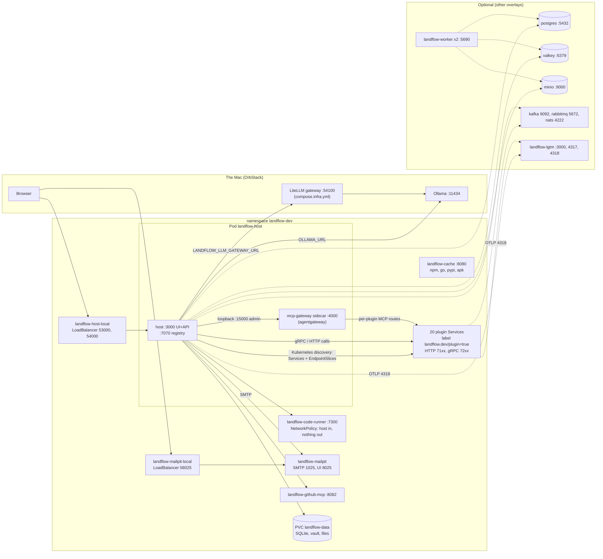

# Landflow on Kubernetes

What runs in the cluster, how the pieces connect, and how the manifests are put together. This page is the map; the
step-by-step with every check is [deployment.md, "Kubernetes"](../deployment.md#kubernetes). To deploy, change or debug,
a Claude skill follows this page: `claude-plugins/landflow-dev/skills/landflow-kubernetes/SKILL.md`.

Everything here is **local only**: the OrbStack cluster (context `orbstack`), namespace `landflow-dev`, images built on
this machine. Nothing in the repository deploys to a cloud or pushes an image ([limitations](../limitations.md)).

## The namespace

The `orbstack` overlay, which is the whole local Landflow (28 Deployments, 30 Services; read from
`kubectl kustomize deploy/k8s/overlays/orbstack`):



Solid arrows are in the `orbstack` overlay; dotted ones appear only with the overlay named under "Optional". Notes on the
picture:

- **One host pod, two containers.** `host` (the image `landflow/host`, built from `deploy/docker/host.Dockerfile`) and
  `mcp-gateway` (agentgateway 1.6, a pinned digest, `deploy/k8s/base/host/deployment.yaml:90`). They share the pod's
  loopback: the host writes the gateway's targets through its admin API on `127.0.0.1:15000`, which is not exposed.
  Concept: [mcp-gateway.md](../mcp-gateway.md).
- **Discovery, not announcing.** Plugins do not register themselves. The host watches Services labelled
  `landflow.dev/plugin=true` and their EndpointSlices (`deploy/k8s/base/host/deployment.yaml:36`,
  `apps/web/src/lib/server/plugins/kubernetes.ts:224`). Its ServiceAccount has a namespaced Role for `get/list/watch` on
  `services` and `endpointslices` and nothing else (`deploy/k8s/base/host/rbac.yaml`).
- **One NetworkPolicy.** Only the code runner has one: ingress from the host on 7300, no egress
  (`deploy/k8s/components/code-runner/code-runner.yaml`). It needs a CNI that enforces policies. Every other Service
  is open to the whole namespace.
- **The Mac is outside the namespace.** Ollama and the LiteLLM gateway run on the Mac and are reached by the name
  `host.docker.internal`. Landledger's API is reached through an ExternalName Service to `host.orb.internal:4810`
  (overlay `orbstack-clickland`). Clickland itself runs in its own namespace, `clickland-dev`.
- **kagent is another cluster.** kagent and Agent Substrate run in a kind cluster (`landflow-kagent`) on the same
  Docker engine, not in this namespace: `deploy/kind/`, `deploy/scripts/kagent-up.sh`, [a2a.md](../a2a.md).

## The plugins

Every plugin is a Deployment plus a Service made to one pattern (`deploy/k8s/base/plugins/text-toolkit.yaml` is the
model): HTTP port `71xx` and gRPC port `72xx`, a Service with label `landflow.dev/plugin: "true"` and annotation
`landflow.dev/grpc-port: grpc`, readiness and liveness on `GET /landflow/v1/health`, `LANDFLOW_REGISTRY_URL=off`,
`LANDFLOW_MCP=off`, `LANDFLOW_REGISTRY_SECRET` from the Secret `landflow-registry`, non-root, read-only root filesystem,
all capabilities dropped, requests 20m CPU and 160Mi memory with a 512Mi limit for most Node and Python plugins (Go plugins 96Mi and 256Mi; browser, agent-shell and web-search differ).

| Plugin | Language, Dockerfile | HTTP / gRPC | Where it is defined | In `orbstack` |
|---|---|---|---|---|
| text-toolkit | Node, `node-plugin.Dockerfile` | 7101 / 7201 | base | yes |
| py-insights | Python, `python-plugin.Dockerfile` | 7102 / 7202 | base | yes |
| go-crypto | Go, `go-plugin.Dockerfile` | 7103 / 7203 | base | yes |
| messaging | Node | 7104 / 7204 | base | yes |
| productivity | Python | 7105 / 7205 | base | yes |
| google-workspace | Go | 7106 / 7206 | base | yes |
| databases | Go | 7107 / 7207 | base | yes |
| landfall | Node | 7108 / 7208 | `components/landfall` | yes |
| triage | Node | 7109 / 7209 | `components/triage` | yes |
| threat-intel | Go | 7110 / 7210 | `components/threat-intel` | yes |
| github | Node | 7111 / 7211 | base | yes |
| browser | Node, `plugins/browser/Dockerfile` (Chrome inside; 2Gi limit, `/dev/shm` volume) | 7112 / 7212 | `components/browser` | yes |
| web-search | Node | 7113 / 7213 | `components/web-search` | yes |
| agent-shell | Node | 7114 / 7214 | `components/agent-shell` | yes |
| ai-sdk | Node | 7115 / 7215 | `components/ai-sdk` | yes |
| linear | Node | 7116 / 7216 | base | yes |
| attio | Node | 7117 / 7217 | base | yes |
| fathom | Node | 7118 / 7218 | base | yes |
| clickland | Node | 7119 / 7219 | base | yes |
| landledger | Node | 7120 / 7220 | `components/landledger` | no: `orbstack-clickland` only |
| grafana | Node | 7121 / 7221 | `components/grafana` | yes |

Each image is `landflow/plugin-<name>:k8s-dev`, built with `--build-arg PLUGIN=<name> --build-arg HTTP_PORT=… --build-arg
GRPC_PORT=…` (the ports in the table). The plugin's own README is in `plugins/<name>/`; the plugin guide is
[plugins.md](../plugins.md).

## Every component

One row per directory under `deploy/k8s/components/` (plus the base). "Host env" is what it sets on the `landflow-host`
Deployment. "orbstack" says whether `deploy/k8s/overlays/orbstack/kustomization.yaml` lists it.

| Component | What it is | Image, built from | Host env and Secrets it sets | Ports | orbstack | Doc |
|---|---|---|---|---|---|---|
| base `host/` | the host, its gateway sidecar, PVC `landflow-data` (5Gi), Role | `landflow/host`, `deploy/docker/host.Dockerfile`; sidecar `cr.agentgateway.dev/agentgateway:v1.6.0` | `LANDFLOW_PLUGIN_DISCOVERY=kubernetes`, `LANDFLOW_SCAN_ON_START=false`, `LANDFLOW_INTERNAL_URL`, `LANDFLOW_PUBLIC_URL`, `LANDFLOW_MCP_GATEWAY*`; optional Secret keys of `landflow-host` and `landflow-registry` | 3000, 7070, 4000 | yes | [deployment.md](../deployment.md#kubernetes) |
| base `plugins/` | 12 plugins (table above) | `landflow/plugin-*` | none on the host | 71xx / 72xx | yes | [plugins.md](../plugins.md) |
| `package-cache` | npm, Go, PyPI and Alpine caches for kagent's sandboxes: four Deployments behind one nginx, a PVC each | `nginx:1.29.0-alpine`, `verdaccio/verdaccio:6.2.0`, `gomods/athens:v0.16.0`, `epicwink/proxpi:1.3.0` (all public) | none | `landflow-cache` 8080 | yes | [a2a.md](../a2a.md#network-for-claude-code) |
| `github-mcp` | GitHub's MCP server with write tools removed, no token in the pod | `ghcr.io/github/github-mcp-server:v2.0.2` (public) | none set; the host uses its in-cluster default address unless `LANDFLOW_GITHUB_MCP_URL` is set | 8082 | yes | [a2a.md](../a2a.md) |
| `browser`, `agent-shell`, `web-search`, `ai-sdk`, `landfall`, `triage`, `threat-intel`, `grafana` | one plugin each (table above); browser sets `LANDFLOW_BROWSER_ALLOWED_DOMAINS`, web-search sets `LANDFLOW_SEARCH_SEARXNG_URL` and `LANDFLOW_SEARCH_DENY_DOMAINS` | `landflow/plugin-<name>` | none | 71xx / 72xx | yes | [triage.md](../triage.md), [web-search.md](../web-search.md) |
| `code-runner` | sandboxed Python and JavaScript for the Code node; read-only root, `noexec` tmp, 2 CPU and 1Gi limits, NetworkPolicy | `landflow/code-runner`, `deploy/docker/code-runner.Dockerfile` | set by the overlay: `LANDFLOW_CODE_RUNNER_URL=http://landflow-code-runner:7300`, `LANDFLOW_CODE_RUNNER_SECRET` from `landflow-host` key `code-runner-secret` | 7300 | yes | [deployment.md](../deployment.md#code-runner) |
| `mailpit` | SMTP sink and web UI for every mail the host sends | `axllent/mailpit:v1.31.6` | set by the overlay: `LANDFLOW_SMTP_HOST=landflow-mailpit`, `_PORT=1025`, `_SECURE=false`, `_IGNORE_TLS=true`, `_FROM` | 1025, 8025 | yes | [deployment.md](../deployment.md#sign-in-email-and-sso) |
| `local-access` | two LoadBalancer Services that OrbStack publishes on the Mac's localhost | none | none | 53000 (host), 54000 (MCP), 58025 (Mailpit UI) | yes | [deployment.md](../deployment.md#the-whole-thing-on-orbstack) |
| `postgres` | Postgres 16 with pgvector (StatefulSet) | `pgvector/pgvector:pg16` | `LANDFLOW_DB=postgres`, `DATABASE_URL` from Secret `landflow-postgres` | 5432 | no (a commented line); `orbstack-queue` | [features/engine.md](../features/engine.md#queue-mode-workers-and-high-availability) |
| `valkey` | Valkey 8, memory only | `valkey/valkey:8-alpine` | `LANDFLOW_VALKEY_URL=redis://valkey:6379/0` | 6379 | no; `orbstack-queue`, `orbstack-brokers` | same |
| `minio` | S3 store for queue mode, data in an `emptyDir` | `pgsty/minio:RELEASE.2026-08-04T00-00-00Z`, start script of `deploy/infra/minio/start.sh` | none (queue-mode sets the S3 variables) | 9000, 9001 | no; `orbstack-queue` | same |
| `queue-mode` | host as 2 mains, `landflow-worker` x2, two PodDisruptionBudgets, Secret `landflow-queue` | the host image (`node worker.mjs` for workers) | `LANDFLOW_EXECUTIONS_MODE=queue`, `LANDFLOW_INSTANCE_ID`, `LANDFLOW_BINARY_STORE=s3`, `LANDFLOW_S3_*`, `LANDFLOW_ENCRYPTION_KEY`, `LANDFLOW_BINARY_SECRET` | worker health 5690 | no; `orbstack-queue` | [deployment.md](../deployment.md#queue-mode-on-kubernetes) |
| `external-services` | Postgres and Valkey you run elsewhere, from a Secret you create | none | `LANDFLOW_DB`, `DATABASE_URL`, `LANDFLOW_VALKEY_URL` from Secret `landflow-external` | none | no | [deployment.md](../deployment.md#kubernetes) |
| `kafka`, `rabbitmq`, `nats` | one broker each, `emptyDir` data | `apache/kafka:4.3.2`, `rabbitmq:4.4.0-management-alpine`, `nats:2.15.1-alpine` | none | 9092; 5672, 15672; 4222, 8222 | no; `orbstack-brokers` | [transports.md](../transports.md) |
| `brokers` | all four brokers (those three and `valkey`) | as above | none | as above | no; `orbstack-brokers` | [deployment.md](../deployment.md#brokers-on-kubernetes) |
| `broker-transports` | points the host and plugins at the brokers: ConfigMap `landflow-transport`, a ConfigMap per plugin, Secret `landflow-transport` | none | `LANDFLOW_TRANSPORT_<KIND>_URL`, `LANDFLOW_TRANSPORT_SECRET` | none | no; `orbstack-brokers` | same |
| `cluster-discovery` | ClusterRole and binding so discovery watches every namespace | none | `LANDFLOW_K8S_NAMESPACES=*` | none | no; `orbstack-cluster-wide` | [deployment.md](../deployment.md#host-settings) |
| `gateway-ingress` | two `Ingress` objects: `/` to `http`, `/mcp` and the OAuth metadata to `mcp` | none | none (the overlay sets the two public URLs) | via the controller | no; `orbstack-ingress` | [deployment.md](../deployment.md#reaching-the-host-from-outside) |
| `gateway-httproute` | the same routes as a Gateway API `HTTPRoute` (use one or the other) | none | none | via the Gateway | no; `orbstack-gateway-api` | same |
| `gateway-landflow-tokens` | gateway sidecar config that accepts Landflow-issued MCP tokens | none | `LANDFLOW_MCP_GATEWAY_ROUTE_POLICIES` | none | no; both ingress overlays | [mcp-gateway.md](../mcp-gateway.md) |
| `gateway-landflow-tokens-idp` | the same plus an identity provider's tokens; use instead of the one above | none | adds `LANDFLOW_OIDC_ISSUER` | none | no; no overlay uses it | [mcp-gateway.md](../mcp-gateway.md) |
| `observability` | `landflow-lgtm`: Collector, Tempo, Prometheus, Loki, Grafana, plus the agent-runs dashboard | `grafana/otel-lgtm:0.39.0` | `OTEL_EXPORTER_OTLP_ENDPOINT`, `LANDFLOW_TRACE_URL`, `LANDFLOW_OTLP_TRACES_URL` | 3000, 4317, 4318 | no; `orbstack-observability` | [observability.md](../observability.md) |
| `clickland-observability` | the same variables, pointed at Clickland's collector in `clickland-dev`; deploys nothing | none | same three, with `clickland-collector.clickland-dev` | none | no; `orbstack-clickland` | [features/clickland.md](../features/clickland.md) |
| `landledger` | the Landledger plugin and an ExternalName Service to Landledger's API on the Mac | `landflow/plugin-landledger` | none | 7120 / 7220, 4810 | no; `orbstack-clickland` | [features/landledger.md](../features/landledger.md#deploying) |

Not components: `deploy/k8s/examples/` holds KEDA `ScaledObject`s (`keda/`), an Envoy Gateway `BackendTrafficPolicy`
(`envoy-gateway/`), a LiteLLM Deployment for a cluster (`llm-gateway/`) and a tool policy (`tool-policy/`). No overlay
applies them, and KEDA is not installed locally ([limitations](../limitations.md)).

## Overlays and how kustomize composes

`deploy/k8s/base` is the host and the twelve base plugins, with no namespace. A **component** (`kind: Component`) is an
optional piece: it adds resources and patches the objects that exist (for example `postgres` adds env vars to
`landflow-host`). An **overlay** names the base, a namespace, and a list of components. Overlays are built on each
other: every other overlay starts with `resources: [../orbstack]` and adds components.

`kubectl kustomize deploy/k8s/overlays/<name>` renders without applying anything. Rendered here, the overlays add this
to the plain `orbstack` result:

| Overlay | Adds | Use it for |
|---|---|---|
| `orbstack` | namespace `landflow-dev`, `:k8s-dev` images with `imagePullPolicy: Never`, the dev Secrets, the host's local URLs, Ollama, Mailpit, code runner, LiteLLM; the components marked "yes" above | the everyday local Landflow |
| `orbstack-brokers` | Kafka, RabbitMQ, NATS, Valkey, ConfigMaps and Secrets for broker transports on the host and seven plugins | trying the broker faces |
| `orbstack-queue` | Postgres, Valkey, MinIO, a second main, two workers, two PodDisruptionBudgets; the host moves to Postgres | queue mode |
| `orbstack-observability` | `landflow-lgtm` and its five ConfigMaps; OTLP export | telemetry without Clickland |
| `orbstack-clickland` | the Landledger plugin and the `landledger-api` ExternalName Service; OTLP to Clickland's collector | the default telemetry, with Clickland running |
| `orbstack-cluster-wide` | a ClusterRole and binding; discovery in every namespace | plugins in other namespaces |
| `orbstack-ingress` | two Ingresses and Landflow-token sign-in at the gateway; host `landflow.localhost` | a Traefik in `landflow-ingress` |
| `orbstack-gateway-api` | an `HTTPRoute` and the same sign-in | Traefik's Gateway provider |

Rules that matter when you compose:

- **Order of components.** A patch only reaches objects already in the build. In `orbstack-clickland`, `landledger` is
  listed first so the telemetry patch also reaches its Deployment (`overlays/orbstack-clickland/kustomization.yaml`).
- **Namespace.** Each overlay repeats `namespace: landflow-dev` because the one in `orbstack` applies only to what that
  overlay lists, not to components added later.
- **Images.** `orbstack` pins every image to `k8s-dev` in `images:` and patches `imagePullPolicy: Never` on every
  Deployment labelled `part-of=landflow`. The cache, GitHub MCP, broker and database pods carry another `part-of`
  (or none), so they pull from their registries.
- **Back to a smaller overlay.** `kubectl apply -k` does not delete what the bigger overlay made. Each overlay's header
  comment lists what to delete.

For a real cluster, copy `overlays/orbstack`: set the namespace, the registry and tags in `images:`, real Secrets,
`LANDFLOW_PUBLIC_URL`, drop the `imagePullPolicy: Never` patch, and add an Ingress. The repository tests none of that.

## Build, apply, roll out

Always name the context. Build with OrbStack's builder; its cluster uses the same Docker engine, so nothing is pulled
or pushed (details: [deployment.md](../deployment.md#build-the-images-orbstack)).

```bash
# host
docker --context orbstack buildx build --builder orbstack --load -f deploy/docker/host.Dockerfile -t landflow/host:k8s-dev .
# a plugin: pick the Dockerfile for its language, the ports from the table above
docker --context orbstack buildx build --builder orbstack --load -f deploy/docker/node-plugin.Dockerfile \
  --build-arg PLUGIN=text-toolkit --build-arg HTTP_PORT=7101 --build-arg GRPC_PORT=7201 -t landflow/plugin-text-toolkit:k8s-dev .
# the code runner
docker --context orbstack buildx build --builder orbstack --load -f deploy/docker/code-runner.Dockerfile -t landflow/code-runner:k8s-dev .

kubectl --context orbstack apply -k deploy/k8s/overlays/orbstack
kubectl --context orbstack -n landflow-dev rollout status deploy --timeout=180s
kubectl --context orbstack -n landflow-dev rollout restart deploy/plugin-text-toolkit   # after a new image under the same tag
```

A new image under the same `:k8s-dev` tag is not picked up by `apply` alone (the manifest did not change): restart the
Deployment. With `imagePullPolicy: Never` a missing image shows as `ErrImageNeverPull`.

## How the host finds plugins

1. The host starts with `LANDFLOW_PLUGIN_DISCOVERY=kubernetes` and lists and watches Services with the label
   `landflow.dev/plugin=true` in `LANDFLOW_K8S_NAMESPACES` (empty: its own namespace; `*`: all, with the ClusterRole).
2. For each Service it takes the gRPC port from the annotation `landflow.dev/grpc-port` (or a port named `grpc`), and
   reads the ready pod addresses from the EndpointSlices.
3. It calls `GetManifest` on the plugin and checks the registry proof: the plugin must hold the same
   `LANDFLOW_REGISTRY_SECRET` ([protocol.md §13](../protocol.md#13-kubernetes-discovery-and-registry-proofs)).
4. Calls go to the ready pod with the fewest calls in flight; scale a plugin to 0 and the Plugins page shows it offline
   with its nodes kept. `LANDFLOW_K8S_SPREAD=service` sends calls through the Service instead.

The variables are in [deployment.md, "Host settings"](../deployment.md#host-settings). The Plugins page shows each
plugin's source as `kubernetes`, the namespace and the Service.

## Queue mode and workers

`orbstack-queue` runs the engine as two mains (`landflow-host`, `RollingUpdate`, data in an `emptyDir`) and two workers
(`landflow-worker`, the host image started with `node worker.mjs`, `apps/web/src/lib/server/cluster/worker-main.ts`).
Runs go on a queue in Valkey, state is in Postgres, files in MinIO. Workers have probes on `/healthz` (port 5690),
drain on SIGTERM for 30 seconds inside a 60-second grace period, and `landflow-host` and `landflow-worker` each have a
PodDisruptionBudget. Scale with `kubectl scale deployment/landflow-worker --replicas=N`. Concept:
[features/engine.md](../features/engine.md#queue-mode-workers-and-high-availability), steps:
[deployment.md](../deployment.md#queue-mode-on-kubernetes).

The worker manifest (`components/queue-mode/worker.yaml`) sets no `LANDFLOW_CODE_RUNNER_URL`, SMTP or LLM gateway
variables: those are set on the host by the `orbstack` overlay only. Check that a Code node or an email node you rely
on works on a worker before you trust it there.

## Probes and resources

| Pod | Probes | Resources |
|---|---|---|
| host | startup `/api/health/live` every 5 s, 60 failures (5 min for boot); readiness `/api/health/ready`; liveness `/api/health/live` | 100m / 384Mi request, 2Gi limit |
| host in `orbstack` | liveness every 20 s with 15 failures (5 min), readiness timeout 10 s | same |
| mcp-gateway sidecar | readiness `/healthz/ready` on 15021 | 20m / 64Mi, 256Mi limit |
| plugins | readiness and liveness `/landflow/v1/health` | see "The plugins" |
| code runner | `/health` | 100m / 128Mi, limit 2 CPU and 1Gi |
| worker | `/healthz` (startup, readiness, liveness) | as the host |

## Secrets

The repository ships **development values only**, in two places: `deploy/.env.example` (the Compose stacks, and the
values the cluster reuses: owner `owner@landflow.test` / `landflow-dev-only`, the code runner secret
`landflow-code-runner-dev-only`, the LLM gateway master key `sk-landflow-dev-master-only`) and the overlays'
`secretGenerator` blocks (`landflow-registry`, `landflow-host`; `landflow-queue`, `landflow-minio`, `landflow-postgres`,
`landflow-transport`, `landflow-rabbitmq` in the components). Those generated Secrets are plain literals in Git.
The host and worker Deployments set `LANDFLOW_PROFILE=development`.

A real deployment would supply its own: create the Secrets outside Git (`landflow-host` keys `encryption-key`,
`owner-email`, `owner-password`; `landflow-registry` key `secret`; `landflow-external` for `external-services`), drop
the dev `secretGenerator` blocks from your overlay, leave `LANDFLOW_PROFILE` unset, and never change the encryption key
once credentials are saved (rotate with `LANDFLOW_ENCRYPTION_KEYS`). The repository provides no sealed-secrets,
external-secrets or cert-manager wiring, and no production overlay. See [deployment.md, "Production
profile"](../deployment.md#production-profile).

## Known traps

Each was checked against the manifests or the code on this branch.

- **Ports clash with Compose.** `local-access` publishes 53000, 54000 and 58025, the same ports Compose publishes for
  the host, the MCP gateway and Mailpit (`deploy/compose.yml:53`, `deploy/compose.infra.yml:78,534`). Run one stack at
  a time.
- **Ollama from inside the cluster.** `http://127.0.0.1:11434` is the pod itself. The overlay sets `OLLAMA_URL` to
  `http://host.docker.internal:11434` for Spotlight and the second brain (`overlays/orbstack/kustomization.yaml:111`),
  but an agent's Ollama model keeps its own Server URL, prefilled with `http://127.0.0.1:11434`
  (`apps/web/src/components/agents/util.ts:43`): change it to the `host.docker.internal` address.
- **Long probes for big local models.** A 30B model on the Mac can starve the laptop for minutes. The overlay gives the
  host liveness 15 failures at 20 s (`overlays/orbstack/kustomization.yaml:100`) instead of the base's 6.
- **Same tag, no rollout.** See "Build, apply, roll out".
- **`apply -k` never deletes.** Moving to a smaller overlay leaves the extras running.
- **`landflow-github-mcp` and the cache pull from public registries**, not from your build; the `Never` patch skips them.
- **Plugin env is read at start.** Editing the broker ConfigMaps needs `rollout restart deploy -l
  app.kubernetes.io/component=plugin`.
- **The host stays at one replica on SQLite.** Two mains need Postgres, Valkey and MinIO (`orbstack-queue`).
- **Landledger and Clickland need their own projects** running (`landledger-api` on the Mac, `clickland-dev`
  namespace); the overlay only points at them.

## Where the docs and the code disagreed

The code wins. These were found while writing this page and are fixed in the docs and in the manifests' comments (no
manifest value changed):

- The base lists twelve plugins; `deploy/k8s/base/kustomization.yaml`, `docs/architecture.md` and
  [deployment.md](../deployment.md#kubernetes) said eight or seven.
- `components/broker-transports` writes a face list for seven plugins (text-toolkit, messaging, go-crypto,
  google-workspace, databases, py-insights, productivity). The other five (github, linear, attio, fathom, clickland)
  keep `http,grpc`. The `orbstack-brokers` header, its comment and deployment.md now say so.
- Still true, and in [limitations.md](../limitations.md): the queue overlay's workers get no code runner, SMTP or LLM
  gateway settings, which only the host Deployment has.

## Change it

| To | Start at |
|---|---|
| add a plugin to the cluster | the skill `landflow-kubernetes`, step "Add a plugin"; model `deploy/k8s/base/plugins/text-toolkit.yaml` |
| add an optional service | a new `deploy/k8s/components/<name>/` with `kustomization.yaml` (`kind: Component`), then list it in an overlay |
| change what the host gets | an env patch in the overlay, or the component that owns the feature |
| change probes or limits | the Deployment in `deploy/k8s/base` (host, plugins) or its component |
| document it | [deployment.md](../deployment.md#kubernetes), this page's tables, `docs/history.md` |
