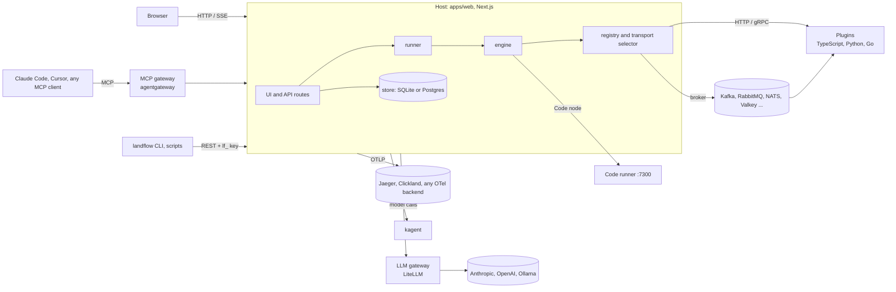
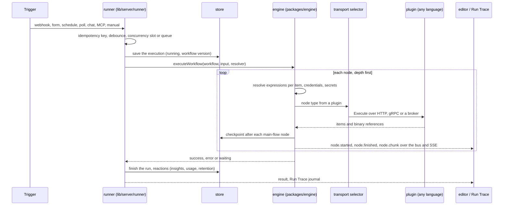

# Platform overview

The whole of Landflow on one page: the processes and how they talk, one run from trigger to Run Trace, where the data
lives, who may do what, the AI parts, how it is watched and where the code sits. Part of [the platform
section](README.md). Each part links to the page that goes deeper; this page does not repeat them.

Landflow is a low-code workflow platform modelled on n8n. Every node is a plugin that any language can write, and the
host finds it over HTTP, gRPC or a message broker. Around the workflows sit agents, a second brain and gateways for
models and MCP.

- [The processes](#the-processes)
- [A run, end to end](#a-run-end-to-end)
- [The data](#the-data)
- [Identity and access](#identity-and-access)
- [The AI parts](#the-ai-parts)
- [Observability](#observability)
- [Kubernetes in one paragraph](#kubernetes-in-one-paragraph)
- [The repository](#the-repository)

## The processes



| Process | What it does | Code |
|---|---|---|
| Host | the UI, the REST API, webhooks, forms, hosted chat, MCP endpoints, and (in regular mode) the runs; the leader also runs schedules, polls and timers | `apps/web` |
| Worker | queue mode only: takes production runs from a Valkey stream and runs them with the same runner (`pnpm worker`) | `apps/web/src/lib/server/cluster/worker-main.ts` |
| Plugins | serve node types; one process each, any language, built with an SDK | `plugins/*`, SDKs in `packages/sdk`, `sdks/go`, `sdks/python` |
| Code runner | runs Code node JavaScript and Python in a fresh locked-down process per run | `services/code-runner` |
| MCP gateway | one MCP URL for every plugin, sign-in, prefixes, rate limits (agentgateway); the host keeps its config in step | `deploy/mcp-gateway`, `apps/web/src/lib/server/mcp/gateway-sync.ts` |
| LLM gateway | LiteLLM in front of the models: virtual keys, spend log, budgets | `deploy/llm-gateway`, `apps/web/src/lib/server/llm-gateway/` |
| Bridge | gives Go and Python plugins the broker kinds their SDK has no driver for | `services/landflow-bridge` |
| CLI | `landflow`: workflows, runs, Git sync, environments, spend, work events | `packages/cli` |
| kagent | an optional agent runtime in its own cluster; Landflow writes the agent's persona and tools to it | [agents.md](agents.md#where-agents-run), [../a2a.md](../a2a.md) |

Around them sit ordinary services: Postgres, Valkey, S3 (MinIO), SMTP (Mailpit), an identity provider (Keycloak), a
secrets manager (OpenBao) and the brokers. `deploy/compose.infra.yml` runs all of them locally. None is needed for a
first start: with no setup the host uses SQLite files in `apps/web/.data` and the plugins you start next to it.

How each pair talks, and the contract behind it:

| From, to | How | Contract |
|---|---|---|
| host to plugin | HTTP or gRPC (the host connects), or a broker (both connect out) | [../protocol.md](../protocol.md), [../transports.md](../transports.md) |
| plugin to host | announces itself to the registry; reads files through `/api/binary` with a per-call token | [../protocol.md](../protocol.md) |
| agent client to host | MCP over Streamable HTTP, through the gateway or straight | [../mcp-gateway.md](../mcp-gateway.md) |
| host to models | provider APIs, or LiteLLM when a credential's Gateway says so | [../llm-gateway.md](../llm-gateway.md) |
| host to kagent | the Kubernetes API (write the agent), A2A (call it) | [../a2a.md](../a2a.md) |
| every process to telemetry | OpenTelemetry (OTLP) | [../observability.md](../observability.md) |

## A run, end to end



1. **A trigger starts it.** Webhooks, forms, app webhooks, the scheduler, the poller, chat, IMAP and MCP triggers each
   live in their own file under `apps/web/src/lib/server` (`webhooks.ts`, `forms.ts`, `scheduler.ts`, `poller.ts`,
   `chat.ts`). They all call `runWorkflow()` (`lib/server/runner/run.ts:64`).
2. **The runner admits it.** It applies the idempotency key, debounce and batching (`trigger-buffers.ts`) and a
   concurrency slot, or puts the run in the FIFO (`runner/queue.ts`). It saves an execution row first.
3. **Where it runs.** In regular mode the runner runs it here (`runSegment`, `runner/run.ts:194`). With
   `LANDFLOW_EXECUTIONS_MODE=queue` a main enqueues production runs on a Valkey stream and a worker takes them
   (`cluster/`, `runner/jobs.ts`).
4. **The engine executes.** `executeWorkflow()` (`packages/engine/src/executor.ts:192`) walks the graph depth first,
   resolves `{{ }}` expressions per item in a sealed realm, and asks the host's resolver for each node type: the
   built-in `core` plugin runs in process (`lib/server/nodes/`), every other node goes to a plugin.
5. **The plugin call.** The transport selector (`lib/server/transports/selector.ts`, `auto.ts`) picks HTTP, gRPC or a
   broker for each call and records why on the `plugin.rpc` span. The plugin's dispatcher runs `node.execute()` and
   sends items back. Files travel as references, not bytes.
6. **Checkpoints and events.** After each main-flow node the run saves a checkpoint, so a crash continues from it. Live
   events go over `bus.ts` and SSE to the editor; in queue mode over Valkey pub/sub.
7. **It finishes, or waits.** A Wait node, a form, an approval or a sub-execution saves the run as `waiting`; a timer or a
   call to `/api/waiting/<id>` resumes it. A finished run fires `onExecutionFinished` (`lib/server/store.ts:77`), which
   `execution-reactions.ts` turns into insights, the usage ledger and retention.
8. **You read it back** in the editor's run view and in the Run Trace, the journal of who did what, with requests
   between agents, waits, artifacts, checks and spend ([../run-trace.md](../run-trace.md)).

The engine knows nothing about HTTP, databases or plugins; the host hands it a node-type resolver
([../architecture.md#the-engine](../architecture.md#the-engine)).

## The data

| What | Where |
|---|---|
| Workflows, versions, executions, checkpoints, waits, users, projects, settings, data tables, audit events | SQLite `<data dir>/landflow.db` (WAL), or Postgres with `LANDFLOW_DB=postgres` |
| Files (binary data) | the filesystem store or S3 (MinIO); deleted with their execution |
| Credentials and settings documents | encrypted files in the data directory, or the database (`LANDFLOW_CONFIG_STORE=database`, the default in queue mode) |
| Agents, sessions, memory | files in the data directory, or the database with the same switch |
| Encryption key | `LANDFLOW_ENCRYPTION_KEY`, or `<data dir>/encryption.key` generated at first use |
| External secrets | OpenBao/Vault, 1Password, AWS, GCP, Azure: read at run time, never stored |

The data directory is `LANDFLOW_DATA_DIR`, else `.data` in the working directory (`lib/server/db/index.ts:27`); for the
host that is `apps/web/.data`. Do not hand-edit it: use the UI, the API or the CLI, and a scratch directory for checks.

Migrations are versioned entries of `MIGRATIONS` in `apps/web/src/lib/server/db/schema.ts`, one SQL text for both
databases, recorded in `schema_version`. In Postgres mode the host keeps a hot in-memory copy and writes through an
ordered queue ([../features/postgres-write-queue.md](../features/postgres-write-queue.md)); finished runs are read back
through `db/reads.ts`. The rules for adding to it are in [server-layers.md](server-layers.md#store-and-migrations).

## Identity and access

The platform works fully without an identity provider.

- **First start.** A fresh instance opens on `/setup`, which calls `POST /api/auth/setup` and creates the owner.
  For Docker and CI, `LANDFLOW_OWNER_EMAIL` and `LANDFLOW_OWNER_PASSWORD` create the owner at boot while no user exists.
- **Password sign-in** is the default: scrypt-hashed passwords, hashed session tokens in the `landflow_session` cookie,
  rate limits, idle and absolute session limits. `LANDFLOW_LOCAL_SIGN_IN` is `all`, `owner` or `off`.
- **Invites.** Owners and admins invite by email with a role (`POST /api/users/invites`); the link is emailed when SMTP is
  configured and always returned so it can be copied. The invitee picks a name and password at `/invite/<token>`.
- **Roles and projects.** Instance roles are owner, admin and member. Every workflow, credential, data table, agent and
  folder belongs to a project (personal or team); project roles are admin, editor and viewer. Sharing gives people or
  projects access to one workflow or credential.
- **API keys** (`lf_...`) act as their user with scopes (`workflows:read`, `workflows:write`, `executions:read`,
  `executions:write`, `run`, `admin`, `scim`, `audit:read`, `brain:read`, `brain:write`). MCP tokens are JWTs the host signs.
- **Optional:** OIDC, SAML 2.0 and SCIM 2.0 provisioning, for an organization that has an identity provider. Without
  one, nothing here is needed.
- **Governance:** node, HTTP-host and MCP-server allow-lists, four-eyes publishing, scheduled publishes, protected
  environments, and a hash-chained audit log.

Every request passes `handler()` and the guard, then the route policy table; the rules are in
[server-layers.md](server-layers.md#access). The details are in [../features/authentication.md](../features/authentication.md)
and [../features/audit-and-governance.md](../features/audit-and-governance.md).

## The AI parts

| Part | What it is | Read |
|---|---|---|
| AI nodes | the AI Agent node and chains; models, memory, tools, retrievers on typed ports; RAG, guardrails, evaluations | [../features/ai.md](../features/ai.md) |
| Spotlight | the builder chat in the editor (and the Home chat): proposes changes, a person applies them | [../assistant.md](../assistant.md), [../spotlight.md](../spotlight.md) |
| Agents | standalone agents with a persona, skills, tools, knowledge, versions and channels; teams of agents | [agents.md](agents.md), [../agents.md](../agents.md), [../agent-teams.md](../agent-teams.md) |
| Second brain | the usage ledger, detectors, the Suggestions inbox, facts, the Brain page, work events and the daily briefing | [../second-brain.md](../second-brain.md), [../work-and-briefings.md](../work-and-briefings.md) |
| Practices | rules in the brain that connected agents follow, approved by a person | [../practices.md](../practices.md) |
| LLM gateway | LiteLLM in front of every model call: keys, budgets, spend by agent and person | [../llm-gateway.md](../llm-gateway.md) |
| MCP | Landflow is an MCP server in five places and a client in three: per-plugin endpoints, the joined `/mcp`, the instance server `/api/mcp` (build and run workflows, and the brain), project servers, MCP Server Trigger workflows | [../mcp-gateway.md](../mcp-gateway.md), [../transports.md](../transports.md) |
| Run Trace | every sub-agent, A2A call and artifact is visible in the run's journal | [../run-trace.md](../run-trace.md) |

A model reply never changes state by itself: it proposes operations that the server validates against the live registry,
and a person applies them (`apps/web/src/lib/shared/assistant-ops.ts`). That rule holds for Spotlight, the Agent
architect and every agent that builds things.

## Observability

Every process speaks OpenTelemetry. The host traces each execution, node and plugin call (`plugin.rpc` says which
transport carried the call and why); the SDKs continue the trace inside the plugin. Logs are JSON lines with the trace
id (`logger` from `lib/server/telemetry`); metrics are bounded-cardinality and served as Prometheus text at
`/api/metrics`; `/api/health/live` and `/api/health/ready` are the probes. The contract (names, attributes) is in
[../observability.md](../observability.md). Jaeger runs in the local infra stack.

## Kubernetes in one paragraph

`deploy/k8s` holds a base (the host with a gateway sidecar, the plugins) and components (Postgres, Valkey, MinIO, the
brokers, queue mode, Ingress) with overlays for the local OrbStack cluster (`landflow-dev` namespace). Plugins are found
by labelled Services. Everything here runs locally only. The pieces and their commands are on
[kubernetes.md](kubernetes.md); the stacks and how each was checked are in [../deployment.md](../deployment.md).

## The repository

```
apps/web/                 the host: src/app (pages and API routes), src/components, src/lib/server, src/lib/shared, test/
packages/engine/          the executor
packages/protocol/        the wire contract: types, JSON Schema, plugin.proto, MCP mapping
packages/sdk/             the TypeScript plugin SDK
packages/transports/      the messaging core, broker drivers, conformance suite, claim check
packages/cli/             the landflow CLI
sdks/go/, sdks/python/    the Go and Python SDKs
plugins/                  the bundled plugins
services/code-runner/     the Code node sandbox
services/landflow-bridge/ broker kinds for Go and Python plugins
deploy/                   compose stacks, Dockerfiles, Kubernetes manifests, gateway configs, scripts
docs/                     every document (index: docs/README.md); this section is docs/platform/
```

Deeper maps: [../architecture.md](../architecture.md) (every subsystem) and [../development.md](../development.md) (where to
start reading, conventions, every test command). The host's own layers are on [server-layers.md](server-layers.md).
