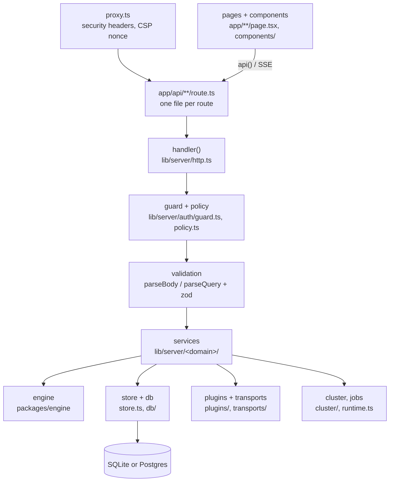

# The host's layers

The host is one Next.js application, `apps/web`. This page lists its layers from the request down to the database: what
each one owns, where it lives, the rule for adding to it, and one new route followed through all of them. Part of [the
platform section](README.md). The skill that does the job is `landflow-server-change`. The rules come from
[../constitution.md](../constitution.md); where this page says "the rule", that page is the source.

Paths below are under `apps/web/src/` unless they start with `packages/`.



- [Pages and routes](#pages-and-routes)
- [handler(), json(), error(), parseBody()](#handler-json-error-parsebody)
- [Access](#access)
- [Validation](#validation)
- [Services](#services)
- [The engine](#the-engine)
- [Store and migrations](#store-and-migrations)
- [Plugins and transports](#plugins-and-transports)
- [Queue mode and workers](#queue-mode-and-workers)
- [Background jobs](#background-jobs)
- [The public API](#the-public-api)
- [The client side](#the-client-side)
- [Example: a new route, end to end](#example-a-new-route-end-to-end)

## Pages and routes

**Owns.** The URL space. `app/**/page.tsx` are pages (the UI); `app/api/**/route.ts` are API routes, one file per path,
exporting `GET`, `POST`, `PUT`, `PATCH` or `DELETE`. `proxy.ts` (Next.js's request proxy) sets the security headers
and the CSP nonce; a new embeddable path goes in its `EMBEDDABLE` list. `instrumentation.ts` registers the bootstrapper
that boots the host.

**Rule.** A route file is thin: parse, call a service, answer. The comment at the top says what the route does and who
may call it (`app/api/goals/route.ts` is a model). Routes hold no SQL and never import `lib/server/db` (`pnpm check:deps`
fails it); they go through a service or the store. Dynamic routes read `params` as a promise:

```ts
type Ctx = { params: Promise<{ id: string }> };
export const GET = handler(async (_request: Request, { params }: Ctx) => { const { id } = await params; /* ... */ });
```

This Next.js (16) differs from older ones: read the guide in `apps/web/node_modules/next/dist/docs/` before writing
Next.js code ([../../apps/web/AGENTS.md](../../apps/web/AGENTS.md)).

## handler(), json(), error(), parseBody()

All in `lib/server/http.ts`.

| Helper | Line | What it does |
|---|---|---|
| `handler(fn)` | `http.ts:38` | waits until the host booted, runs the auth guard and the rate limit, runs `fn` as the caller inside an audit context, and turns a thrown error into JSON |
| `json(data, init?)` | `http.ts:13` | a JSON response; `init` is a status number or a `ResponseInit` |
| `error(message, status = 400, extra?)` | `http.ts:17` | `{ error, ...extra }` with the status |
| `parseBody(request, schema, options?)` | `http.ts:144` | the JSON body checked with a zod schema, capped at `LANDFLOW_MAX_BODY_BYTES` (413 above it); returns `{ ok: true, data }` or `{ ok: false, response }` |
| `parseQuery(request, schema)` | `http.ts:162` | the query string checked the same way |

Errors: throw an `HttpError` (`lib/server/errors.ts:25`: `message, status, { code, details, expose }`) and let `handler()`
answer it as `{ error, code, ...details }`. A domain error extends `HttpError` and names itself with a literal on the
first line of its body (`static readonly errorName: string = 'GoalError';`, as in `lib/server/goals/store.ts`), because the
production bundle minifies class names. A `ZodError` answers 400; anything else is a generic 500 with the request id, and
the message goes to the log only. Do not catch a domain error in a route only to answer it.

**Rule.** Never call `request.json()`. Never `Number(param)` straight into a query: use `parseQuery` and, for lists,
`pageSchema` and `limitParam()` from `lib/server/pagination.ts`.

## Access

**Owns.** Who may call a route, and what each caller may see.

| Piece | Where | What it decides |
|---|---|---|
| Public paths | `lib/shared/auth-paths.ts` (`PUBLIC_ROUTES`) | the paths that answer without a session or key; each authenticates itself (a signed token, a webhook secret) |
| The guard | `lib/server/auth/guard.ts:122` (`guardRequest`) | session cookie, `lf_` API key or MCP token; refuses a cookie-authenticated write with a foreign `Origin` |
| The policy table | `lib/server/auth/policy.ts:28` (`routePolicy`) | the API-key scope a route needs, the role action, whether it is session-only |
| Resource rules | `lib/server/auth/policy.ts:156` (`resourceRule`) | which resource a path names (workflow, credential, data table, agent, agent team, execution) and what the method does to it, checked against the caller's projects |
| Project access | `lib/server/projects/access.ts` | `canResource`, `requireResource`, `visibleIds`, `filterVisible`, `withOwnership` |
| The caller | `lib/server/projects/http.ts` (`routeActor()`) | the signed-in user of the request |

**Rule.**

- Every route has a policy entry or a check of its own in the handler. A route with no entry falls to
  `{ scope: 'admin', fallback: true }`: an API key needs the `admin` scope and a session needs nothing extra. Add a line
  to `routePolicy()` for anything that is not a plain admin route.
- Every id a caller sends is checked against the caller's projects. Answer 404, not 403, when the caller may not know the
  resource exists. For lists, check once per kind (`visibleIds`, `filterVisible`), never `canResource` per item.
- Every security-relevant change records `recordAudit()` (`lib/server/audit/index.ts:191`) in the library function, not
  the route. A high-value change goes through `auditedTransaction()` (`audit/index.ts:87`).
- `test/policy-coverage.test.ts` walks every `route.ts` and fails a mutating route that is not public, is named by no
  policy entry (the fallback does not count) and has no check of its own in the handler.

More in [../features/authentication.md](../features/authentication.md) and
[../features/audit-and-governance.md](../features/audit-and-governance.md).

## Validation

**Owns.** The shape of every body and query.

- Shared shapes (workflows, nodes, run profiles) are in `lib/server/schemas.ts`.
- A domain keeps its own: `lib/server/goals/schema.ts`, `lib/server/tasks/schema.ts`, `lib/server/transports/schema.ts`,
  `lib/server/agents/http.ts` (`agentConfigSchema`). A small route may declare its schema inline.
- Use `z.strictObject` for a body whose stray keys are mistakes; use `.passthrough()` only where the builder owns the
  shape (`agentConfigSchema`).
- Code that the browser loads must not build zod schemas (the production CSP has no `'unsafe-eval'`); keep them in a
  server-side `*-schema.ts`.

**Rule.** Bound every string and array (`.max(...)`). A body that can be large says so with `maxBytes`.

## Services

**Owns.** The behaviour. `lib/server/<domain>/` is one directory per domain, with a `store.ts` for its data, a `service.ts`
or `views.ts` for its rules, and a `schema.ts` for its request shapes.

| Area | Directories and files |
|---|---|
| Runs | `runner.ts` over `runner/`, `waits.ts`, `retries.ts`, `concurrency.ts`, `idempotency.ts`, `trigger-buffers.ts` |
| Triggers | `webhooks.ts`, `forms.ts`, `app-webhooks.ts`, `scheduler.ts`, `poller.ts`, `imap-idle.ts`, `chat.ts` |
| Plugins | `plugins/`, `transports/`, `nodes/` (the built-in `core` plugin), `composites.ts` |
| Data | `db/`, `store.ts`, `binary/`, `datatables/`, `versions.ts`, `folders.ts`, `variables.ts`, `config-store.ts` |
| People and access | `auth/`, `scim/`, `projects/`, `governance/`, `environments/`, `sync/`, `secrets/`, `credentials/`, `audit/` |
| AI | `agents/`, `agent-teams/`, `assistant/`, `rag/`, `evaluations/`, `ai-usage/`, `llm-gateway/`, `brain/`, `practices/`, `a2a/`, `kagent/` |
| MCP | `mcp/` |
| Cluster | `cluster/` |
| Telemetry | `telemetry/` |

**Rules.**

- Reuse the sibling. Find the nearest existing route and service (grep) and follow it; two ways of doing one thing is a bug.
- Configuration is read only through `lib/server/config` (`envInt`, `envFlag`, `envString`, `envUrl`), and every variable is
  an entry of `CONFIG_CATALOG` in `lib/server/config/catalog.ts`. Then run `pnpm --filter @landflow/web gen:config-docs`.
- Process-wide state lives only in `singleton()` (`lib/server/singleton.ts:24`), one exported key per object; no
  `globalThis.__x` and no mutable module state, because Next.js compiles routes into separate module graphs.
- The store does not call up into features. It emits an event (`onExecutionFinished`, `store.ts:77`), and the feature
  subscribes at boot (`execution-reactions.ts`).
- Every outbound request to a URL a user, a webhook or a model can influence goes through `safeFetch`
  (`lib/server/net/safe-fetch.ts`). Never add a bare `fetch` to such a URL.
- Log with `logger` from `lib/server/telemetry`, never `console.*`; never put a secret in a log line, span or audit detail.
- `lib/shared/` is code both the UI and the server run. It must not import `lib/server` values (`pnpm check:deps`).
- Split a file that passes about 800 lines along its own section comments.

## The engine

**Owns.** Executing a workflow: the data model (items with `json`, `binary`, `pairedItem`), depth-first scheduling,
expressions, sub-nodes, retries, scopes. It lives in `packages/engine/src` (`executor.ts:192` `executeWorkflow`), knows
nothing about HTTP, databases or plugins, and reads no environment. The host gives it a `NodeTypeResolver` and gets events
and a result back.

**Rule.** Engine code stays free of host imports (`packages-not-apps`). A change to what an expression may do changes both
sandbox backends (`packages/engine/src/sandbox/`). See [../features/engine.md](../features/engine.md).

## Store and migrations

**Owns.** All persistent data. `lib/server/store.ts` is the workflow and execution store (`store`, a singleton);
`lib/server/db/` is the database: `database.ts` (`Database`: `all`, `get`, `upsert`, `insertNew`, `delete`, `transaction`),
`schema.ts` (migrations and tables), `postgres.ts` and `hot-mirror.ts` (Postgres mode), `reads.ts` (the async read seam for
finished runs).

**Rules.**

- **Migrations** are entries of `MIGRATIONS` in `db/schema.ts`. Append a new one at the end with a version above the
  highest existing one (grep it; versions are not in file order). One SQL text for SQLite and Postgres (`TEXT`, `BIGINT`,
  `DOUBLE PRECISION`, JSON in `TEXT`). Never edit a shipped migration. A column a shipped `CREATE TABLE` gained later goes in
  `addColumns`. A new table also goes in `TABLES` (its primary key) in the same file. `test/migrations-order.test.ts` fails
  a migration numbered below an existing one.
- **Writes** go through the `Database` write methods so Postgres mode can replay them; several rows change in one `transaction()`.
- **SQL** uses `?` parameters, never values pasted into the text (the prepared-statement cache is keyed by SQL text).
- **Lists** are capped and paged by a keyset cursor; filter by visibility in SQL, not after the fetch.
- **Finished runs** are read through `await store.loadExecution(id)` and the journal's `*Async` readers.
  `store.getExecution` is for runs in flight; `test/execution-reads.test.ts` fails a new caller.
- Nothing on a hot path does work proportional to history.

Deeper: [../architecture.md#storage](../architecture.md#storage),
[../features/postgres-write-queue.md](../features/postgres-write-queue.md).

## Plugins and transports

**Owns.** Finding plugins and calling them. `lib/server/plugins/registry.ts` (`PluginRegistry`, the `registry` singleton)
holds every plugin's manifest and endpoints; plugins announce themselves, are listed statically, are found by a port scan,
or by Kubernetes discovery (`plugins/kubernetes.ts`). `plugins/clients.ts` has the HTTP and gRPC clients.
`lib/server/transports/` picks a transport per call (`selector.ts`, `auto.ts`, `breaker.ts`) and holds the broker drivers'
glue (`brokers.ts`, `broker-provider.ts`). `lib/server/nodes/` is the built-in `core` plugin that runs in process.

**Rule.** The contract is `packages/protocol` ([../protocol.md](../protocol.md)). A change to a wire shape changes the
protocol package, the three SDKs and the docs together. Re-record the manifest fixtures when a plugin's nodes change
([../development.md](../development.md#recorded-plugin-manifests)). See also [sdk/README.md](sdk/README.md).

## Queue mode and workers

**Owns.** Running production executions on other processes. `LANDFLOW_EXECUTIONS_MODE=queue` makes mains enqueue runs on a
Valkey stream and workers (`pnpm worker`, `lib/server/cluster/worker-main.ts`) take them with the same runner. The leader
(elected with a TTL key and a fencing token) runs the timers. `lib/server/cluster/` holds the coordinator, leader,
dispatch, workers and the Valkey client.

**Rule.** Anything the worker imports must work without the UI. A change to the boot, `instrumentation.ts`, the proxy or
anything the worker imports also needs `next build` and the queue stack's end-to-end script (see
[../constitution.md](../constitution.md#testing-and-the-regression-gate)). State that must be shared across processes goes
through Valkey (or the database), not memory.

## Background jobs

**Owns.** Everything that runs without a request. `lib/server/runtime.ts` has one service table, `SERVICES`
(`runtime.ts:121`), that both the main (`startRuntime({ role: 'main' })`) and the worker boot from. Each entry names its
`roles`, whether it is `required`, whether it runs only on the `leader`, and its `stop`. Schedules, polls, timers, retries,
alerts, retention, the spend import and the brain are entries of it.

**Rule.**

- A new background service is a new entry in `SERVICES`. Leader-only work goes through `leaderService()`
  (`lib/server/cluster/index.ts:82`) by setting `leader: true`.
- Shutdown goes through `onShutdown()` (`lib/server/lifecycle.ts:55`) or the entry's `stop`. Anything that buffers
  (telemetry, the write queue, the audit outbox) registers a shutdown step.
- Routes do not import the runtime: `handler()` waits on `whenReady()` (`lifecycle.ts:188`).

## The public API

**Owns.** The OpenAPI 3.1 document at `GET /api/openapi.json` (`lib/server/openapi.ts:2861` `openApiDocument`). The
request bodies of workflows and row filters come from the routes' own zod schemas; every other operation names the scope
the guard wants.

**Rule.** A route that is part of the public API gets an entry there (`add('post', '/api/...', { tag, id, summary, body, responses })`).
`test/openapi.test.ts` checks that every documented path and method is a real route and that the documented scope matches
`routePolicy()`. Every route, public or not, is listed in [../reference/api.md](../reference/api.md).

## The client side

**Owns.** The browser. Pages are `app/**/page.tsx`; components are in `components/<area>/`; shared building blocks are in
`components/ui` (`Dialog`, `EmptyState`, `Segmented`, `SearchInput`, `StatCard`, `Sheet`, `chat.tsx`) and
`components/shell/page-header.tsx`. `lib/client/api.ts` has `api()` (a `fetch` that throws `ApiError` and sends you to
sign-in on 401) and `streamEvents()` for SSE. `lib/client/live.ts` shares one `EventSource` for the tab. State that
several components share is a `zustand` store (`components/projects/use-projects.ts`). `lib/shared/` holds types and rules
that the UI and the server both run (composite checks, run checks, Spotlight's operations).

**Rules.**

- Use the shared words, type scale and controls ([../ui-review.md](../ui-review.md)). Never draw a second dialog.
- A poll, heartbeat or reload after a live event calls `api(path, { background: true })`, or an open tab keeps its session alive.
- The phone layout sits behind `max-md:` or `usePhone()` and never changes the desktop ([../mobile.md](../mobile.md)).
- While AI builds, the canvas stays visible.
- Check a UI change at 1440 by 900 and at 390 by 844.

## Example: a new route, end to end

A small feature: a person pins workflows, `GET /api/pins` and `POST /api/pins { workflowId }`. The code below was run in a
scratch checkout: the test passed, `tsc --noEmit` was clean and `policy-coverage`, `migrations-order` and `openapi` still
passed; the files were then removed. Use it as a pattern, not as code to paste.

**1. Migration**, appended at the end of `MIGRATIONS` in `lib/server/db/schema.ts` (the number was 2905 above a highest
of 2904; grep for the current highest), and the table in `TABLES`:

```ts
// PIN01: a person's pinned workflows (docs/platform/server-layers.md)
{
  version: 2905,
  name: 'workflow_pins',
  statements: [`CREATE TABLE IF NOT EXISTS workflow_pins (user_id TEXT NOT NULL, workflow_id TEXT NOT NULL, created_at TEXT NOT NULL, PRIMARY KEY (user_id, workflow_id))`],
},
// ... and in TABLES:
workflow_pins: ['user_id', 'workflow_id'],
```

**2. Schema**, `lib/server/pins/schema.ts`:

```ts
import { z } from 'zod';
export const pinBodySchema = z.strictObject({ workflowId: z.string().min(1).max(100) });
```

**3. Store**, `lib/server/pins/store.ts` (plain data, capped list, `?` parameters, writes through `upsert`):

```ts
import { database } from '../db';
const db = () => database();

export function pinsOf(userId: string, limit = 200): string[] {
  return db()
    .all<{ workflow_id: string }>('SELECT workflow_id FROM workflow_pins WHERE user_id = ? ORDER BY created_at DESC LIMIT ?', userId, limit)
    .map((row) => row.workflow_id);
}
export function addPin(userId: string, workflowId: string): void {
  db().upsert('workflow_pins', { user_id: userId, workflow_id: workflowId, created_at: new Date().toISOString() });
}
```

**4. Service**, `lib/server/pins/service.ts` (the rule: the workflow exists and the caller can read it):

```ts
import { HttpError } from '../errors';
import { requireResource } from '../projects/access';
import type { UserRecord } from '../auth/users';
import { store } from '../store';
import { addPin } from './store';

export function pinWorkflow(actor: UserRecord, workflowId: string): void {
  if (!store.getWorkflow(workflowId)) throw new HttpError('Workflow not found', 404);
  requireResource(actor, 'workflow', workflowId, 'read');
  addPin(actor.id, workflowId);
}
```

**5. Route**, `app/api/pins/route.ts` (thin):

```ts
import { handler, json, parseBody } from '@/lib/server/http';
import { pinBodySchema } from '@/lib/server/pins/schema';
import { pinWorkflow } from '@/lib/server/pins/service';
import { pinsOf } from '@/lib/server/pins/store';
import { routeActor } from '@/lib/server/projects/http';

export const dynamic = 'force-dynamic';

export const GET = handler(async () => json({ pins: pinsOf(routeActor().id) }));
export const POST = handler(async (request: Request) => {
  const body = await parseBody(request, pinBodySchema);
  if (!body.ok) return body.response;
  pinWorkflow(routeActor(), body.data.workflowId);
  return json({ ok: true }, 201);
});
```

**6. Policy**, one line in `routePolicy()` (`lib/server/auth/policy.ts`), before the fallback. Without it only an API key
with the `admin` scope reaches the route:

```ts
if (under('/api/pins')) return { scope: read ? 'workflows:read' : 'workflows:write' };
```

**7. Test**, `test/pins.test.ts`. Set the environment before the dynamic imports; `test/setup.ts` signs the call in as a
synthetic owner:

```ts
Object.assign(process.env, { LANDFLOW_DATA_DIR: mkdtempSync(join(tmpdir(), 'landflow-pins-')), LANDFLOW_REGISTRY_GRPC_PORT: 'off', LANDFLOW_SCAN_ON_START: 'false', LANDFLOW_PLUGINS: '' });
const { GET, POST } = await import('@/app/api/pins/route');
const { store } = await import('@/lib/server/store');
const post = (body: unknown) => POST(new Request('http://localhost:3000/api/pins', { method: 'POST', headers: { 'content-type': 'application/json' }, body: JSON.stringify(body) }));
// pins a saved workflow (201) and lists it; a stray key is 400; an unknown workflow is 404
```

**8. Docs.** The route in `docs/reference/api.md`, the feature page, `docs/limitations.md` and `docs/roadmap.md` if it adds
or closes something, a row in `docs/history.md`. Add the route to `lib/server/openapi.ts` only if it is part of the public
API.

**9. Check.**

```bash
(cd apps/web && npx vitest run test/pins.test.ts test/policy-coverage.test.ts test/migrations-order.test.ts test/openapi.test.ts)
pnpm typecheck
```

Before a pull request, the whole gate: `(cd apps/web && npx vitest run) && pnpm typecheck && pnpm test && pnpm check:deps`.
